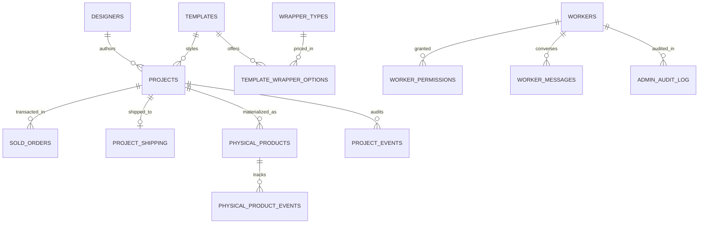
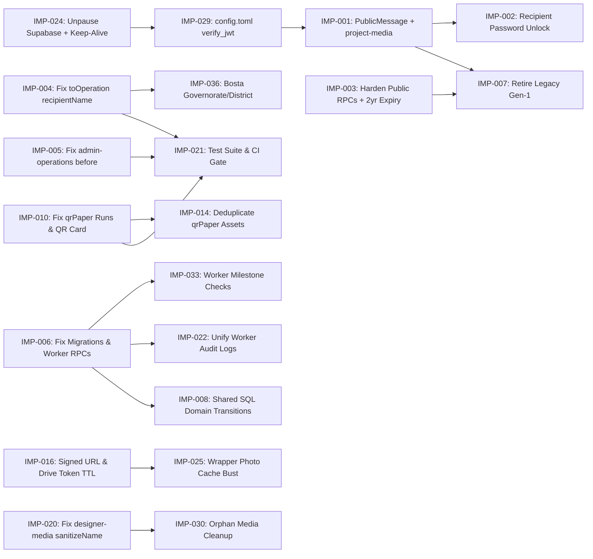

# Dearune — Comprehensive Codebase Audit & Engineering Improvement Plan

**Repository Audited:** `https://github.com/MohamedAbdo1412/Dearune` (`Dearune-main` archive, 214 files inspected)  
**Application Stack:** React 19.2 + Vite 8 + Tailwind CSS 4 + Shadcn/Radix UI + Supabase (PostgreSQL 17, Auth, Storage, Realtime, 16 Deno Edge Functions, 29 SQL Migrations) + Cloudflare Workers Static Assets (`wrangler.jsonc`)  
**Audit Scope:** Full-stack, line-by-line inspection of 100% of source files present in the repository archive (`src/`, `supabase/functions/`, `supabase/migrations/`, `scripts/`, `public/`, root configurations, and documentation).

## 1. Executive Summary

### 1.1 System Overview
**Dearune** is a bespoke physical-and-digital correspondence studio platform operating in Egypt (EGP primary currency, Bosta courier integration, bilingual English/Arabic support). It serves four distinct personas across four runtime surfaces inside a single React SPA:

1. **Public Visitors & Recipients (`/` and `/message/:publicId`)**: A marketing landing page with an editorial antique-paper aesthetic and a QR-code recipient reader that unlocks a keepsake letter, three mounted photographs, and an optional voice note once the physical item arrives (or immediately upon activation for digital items).
2. **Designers (`/create`)**: A custom 3D page-turning book pipeline (`CreateBook.jsx` + `bookMachine.js`) where external or studio designers authenticate with a 6-digit Designer ID and 6-digit one-time passcode (`designer-login` custom HS256 JWT), compose letters using versioned templates (`memorial-message` v1), crop photos (`react-easy-crop`), attach audio, encrypt local drafts in `localStorage` + `IndexedDB` (`AES-GCM` via Web Crypto), and hand over configured Dearunes to the studio (`designer-projects`).
3. **Studio Administrators (`/admin/*`)**: A full-featured back-office dashboard authenticated via Supabase Auth (`admin_users` table) covering Overview KPIs, Operations (physical unit tracking, A4 QR production paper PDF generation via `pdf-lib`, Bosta `.xlsx` manifest export via `exceljs`), Designers & Dearune lifecycle management (`admin-dearunes`), Templates & Wrappers catalog merchandising, Immutable Sales Ledger (`sold_orders`), Financial reporting, QA QR Scanner (`jsqr` + `BarcodeDetector`), Worker user/permission management (`admin-workers`), and Worker-Admin private Inbox (`worker_messages`).
4. **Workshop Workers (`/worker/*`)**: A permission-gated royal-blue dashboard (`workers` + `worker_permissions` tables, enforced by 24 `SECURITY DEFINER` PostgreSQL RPCs) providing scoped access to Operations, Designers, QA, Financial categories, and private Admin messaging, plus three standalone installable PWAs (`/admin/qa`, `/admin/operations`, `/create`).

### 1.2 Overall Engineering Health Assessment
The codebase exhibits strong visual craftsmanship, thoughtful domain modeling (immutable sales ledger with void-and-replace semantics, append-only audit trails, fine-grained DB-enforced worker permissions, and client-side WebP optimization), and clear separation of visual themes (`book.css`, `landing.css`, `worker.css`).

However, rapid schema evolution across **29 SQL migrations** and **three successive architectural generations** (`orders`/`messages` -> `projects`/`sold_orders`/`project_shipping` -> `physical_products` milestone refactor in migrations `20261025000001`–`20261025000007`) has introduced **critical runtime defects, broken public recipient experiences, data corruption in courier exports, and security/privacy leaks**.

| Engineering Dimension | Health Rating | Key Observation |
| :--- | :--- | :--- |
| **Architecture & System Design** | **Amber (Moderate Risk)** | Coexistence of legacy (`orders`/`messages`) and current (`projects`/`sold_orders`) schemas; duplicated business logic between Edge Functions (`admin-dearunes`, `admin-operations`) and 24 SQL `SECURITY DEFINER` RPCs. |
| **Runtime Reliability & Correctness** | **Red (Critical Defects)** | 11 confirmed runtime bugs break core workflows: broken public photo/audio rendering (`project-media` returns JSON to ``/`<audio>`), permanently unreadable password-protected letters, crashed `admin-operations` `ensure` action (`before` undeclared), crashed `worker_ensure_operations` (`v_row.status` dropped), broken `worker_mark_dearune_shipped` (`ON CONFLICT` partial index mismatch), and Bosta customer name overwrite (`designerName` overwrites `recipientName`). |
| **Security & Access Control** | **Red (High Risk)** | Legacy `get_public_message` RPC granted to `anon` leaks full private letter body/headline/recipient even when `available = false` and ignores `qr_token_hash`; 2-year reading expiry window is never enforced on public reads; `supabase/config.toml` omits `verify_jwt = false` for `project-media`, `designer-templates`, and `admin-dearunes`. |
| **Database & Migration Integrity** | **Red (High Risk)** | Clean database initialization (`supabase db reset`) fails because migrations `20261023000003` and `20261023000008` were retroactively edited to reference columns (`pp.delivered_at`, `pp.shipped_at`, `pp.manufacturing_completed_at`, `pp.sold_at`) that are not created until migration `20261025000001`. |
| **Performance & Resource Efficiency** | **Amber (Moderate Risk)** | `buildQrPaperPdf` calls `loadAssets(doc)` twice per PDF, embedding 5 TTF fonts and two 12–14 MB paper PNGs into every PDF document twice; Admin pages (`Designers`, `Financial`, `Overview`, `OperationsPrint`) hydrate entire tables unpaginated on every load. |
| **Testing, CI/CD & DevOps** | **Red (High Risk)** | `package.json` references `vitest` (`tests/`) and `playwright` (`e2e/`), but neither directory is committed to the repository; `.github/workflows/deploy.yml` runs zero lint/test steps and is currently failing on every push to `main` because the linked free-tier Supabase project (`xwgegarncnxswiswsufx`) is paused. |

### 1.3 Summary of Top P0 Priorities (Immediate Action Required)
1. **IMP-001 (P0 — Public Recipient Media Broken):** Fix `PublicMessage.jsx` and `supabase/functions/project-media/index.ts` so `` and `<audio src>` resolve actual media streams/signed URLs instead of receiving `{ "url": "..." }` JSON with `Content-Type: application/json`, and render the authentic `MemorialLetter` component.
2. **IMP-002 (P0 — Password-Protected Letters Permanently Unreadable):** Implement end-to-end password hashing, verification, and unlock UI across `CreateBook.jsx`, `designer-projects`, `get_public_project_message`, `project-media`, and `PublicMessage.jsx`.
3. **IMP-003 (P0 — Data Leak in Legacy `get_public_message` RPC & Unenforced 2-Year Expiry):** Revoke or harden `get_public_message(text, boolean)` so `anon` cannot read sealed/unpaid letters without a valid token, and enforce `first_activated_at + interval '2 years' > now()` in `get_public_project_message` and `project-media`.
4. **IMP-004 (P0 — Bosta Manifest & Operations Customer Name Corruption):** Fix `toOperation()` in `src/services/operations.js:124` (`recipientName: row.recipient_name || ''` instead of `designerName || row.recipient_name || ''`) so Bosta courier shipments are addressed to the customer rather than the designer.
5. **IMP-005 (P0 — `admin-operations` & `designer-media` Edge Function Bugs):** Fix the undeclared `before` variable in `supabase/functions/admin-operations/index.ts:153` and fix `sanitizeName` default `'print'` in `supabase/functions/designer-media/index.ts:46–49, 167` so non-fixed uploads do not overwrite each other.
6. **IMP-006 (P0 — Broken SQL Migrations & Worker RPC Crashes):** Fix chronological column ordering across migrations `20261023000002`–`20261025000005`, remove dropped `v_row.status` references in `worker_ensure_operations`, fix the partial unique index `ON CONFLICT` clause in `worker_mark_dearune_shipped`, and add missing `verify_jwt = false` entries in `supabase/config.toml`.

## 2. Repository Inventory and Audit Coverage

### 2.1 Audit Coverage Summary
Every file present in the `Dearune-main` repository archive (**214 files total**) was inspected. Source code files across frontend, backend Edge Functions, SQL migrations, build scripts, and configurations (**168 text/code files, 29,842 lines of code**) were read line-by-line, and binary assets (**46 font, image, and template files**) were inventoried and cross-referenced against their code consumers.

| Subsystem | File Count | Status | Coverage |
| :--- | :--- | :--- | :--- |
| Root Configurations, CI/CD, Worker & Scripts | 16 files | Inspected in full | 100% |
| Documentation & Scratch Scripts (`docs/`, `.opencode/`, `find_archive.*`) | 7 files | Inspected in full | 100% |
| Public Static Assets, PWA Manifests & Service Workers (`public/`) | 49 files | 8 text files read in full; 41 binary assets inventoried | 100% |
| Supabase Config & Deno Edge Functions (`supabase/config.toml`, `supabase/functions/`) | 22 files | Inspected in full | 100% |
| Supabase PostgreSQL Migrations (`supabase/migrations/`) | 29 files | Inspected in full | 100% |
| Frontend Core, Lib, Hooks, PWA, Policies & Data (`src/lib`, `hooks`, `pwa`, `policies`, `data`) | 17 files | Inspected in full | 100% |
| Frontend Service Layer (`src/services/`) | 34 files | Inspected in full | 100% |
| Frontend Templates & Create Book Pipeline (`src/templates/`, `src/pages/create/`) | 28 files | Inspected in full | 100% |
| Frontend Shared & Admin/Book UI Components (`src/components/`) | 35 files | Inspected in full | 100% |
| Frontend Public, Admin & Worker Pages (`src/pages/`) | 36 files | Inspected in full | 100% |
| Frontend Stylesheets (`src/styles/`, `src/App.css`, `src/index.css`) | 7 files | Inspected in full | 100% |
| **Total Repository Files** | **214 files** | **Complete** | **100%** |

### 2.2 Complete Examined File Inventory

#### A. Root Configurations, Build Scripts, and Deployment (`16 files`)
- `.env.example` — Environment variable template for Vite client and Supabase Edge Functions.
- `.github/workflows/deploy.yml` — GitHub Actions workflow deploying Supabase migrations and Edge Functions on push to `main`.
- `.gitignore` — Git ignore rules (`node_modules`, `dist`, `.env*`, `.supabase`).
- `.oxlintrc.json` — Oxlint static analysis configuration (`correctness: error`, `suspicious: warn`).
- `components.json` — Shadcn UI configuration (`radix-nova` style, Tailwind v4 CSS variables, `@/` aliases).
- `index.html` — SPA HTML entry point, CSP `<meta>` tag, font preconnects, and dynamic manifest link.
- `package.json` — Dependencies, devDependencies, and npm scripts (`dev`, `build`, `lint`, `test`, `test:e2e`, `icons`, `pwa:icons`).
- `skills-lock.json` — Agent skills lockfile (`web-design-guidelines`, `shadcn`).
- `supabase/config.toml` — Supabase CLI project config and per-function `verify_jwt` settings.
- `vite.config.js` — Vite 8 bundler config with `@vitejs/plugin-react`, `@tailwindcss/vite`, and manual Rollup chunking (`pdf-lib`, `exceljs`, `cropper`, `qr`).
- `vitest.config.js` — Vitest unit test runner config (`environment: 'node'`, `include: ['tests/**/*.test.{js,mjs}']`).
- `worker.js` — Cloudflare Worker entry point serving static assets with SPA `index.html` fallback and security headers.
- `wrangler.jsonc` — Cloudflare Workers deployment config (`dearune`, compatibility date `2026-04-08`, `./dist` assets).
- `scripts/generate-app-icons.mjs` — Resvg-based PNG generator for PWA icons.
- `scripts/generate-app-pwa.mjs` — Generator for scoped PWA webmanifests (`dearune-qa`, `dearune-operations`, `dearune-designer`) and service workers (`sw-qa.js`, `sw-operations.js`, `sw-designer.js`).
- `scripts/generate-brand-icons.mjs` — Brand favicon and Apple touch icon generator.

#### B. Documentation & Root Scratch Files (`7 files`)
- `README.md` — High-level overview, environment setup, and architecture summary.
- `docs/architecture.md` — Legacy architecture reference documenting the initial `orders`/`messages` model.
- `docs/asset-licenses.md` — Font and image asset license registry (OFL-1.1 fonts, Bosta template, paper textures).
- `docs/worker-dashboard.md` — Detailed specification of the Worker Dashboard, permission matrix, RPC list, and known test baseline.
- `.opencode/pending-session-summary.md` — Uncommitted AI assistant session scratch file tracked in git.
- `find_archive.js` & `find_archive.mjs` — Developer scratch scripts left in repository root.

#### C. Public Static Assets & Service Workers (`public/` — `49 files`)
- `public/_headers` — Cloudflare Pages/Assets security headers (`X-Frame-Options`, `X-Content-Type-Options`, `Referrer-Policy`, `Permissions-Policy`, `Content-Security-Policy`).
- `public/manifests/dearune-designer.webmanifest`, `dearune-operations.webmanifest`, `dearune-qa.webmanifest` — Scoped PWA manifests.
- `public/sw-designer.js`, `public/sw-operations.js`, `public/sw-qa.js` — Scoped pass-through Service Workers.
- `public/bosta/MassUploadTemplate-Ar.xlsx` — Official Bosta courier bulk upload Excel template.
- `public/qr-paper/paper_front.png` (14.4 MB), `public/qr-paper/paper_back.png` (12.6 MB), `public/qr-paper/fonts/*.ttf` (5 TTF font files: `Allura`, `Amiri`, `CinzelDecorative`, `CormorantGaramond`, `Inter`).
- `public/brand/logo.svg`, `public/favicon.svg`, `public/favicon-32.png`, `public/apple-touch-icon.png`, `public/app-icons/**` (24 PNG/SVG icons), `public/landing/*.png` (3 WebP-encoded images named `.png`).

#### D. Supabase Edge Functions (`supabase/functions/` — `21 files`)
- `supabase/functions/_shared/auth.ts` — Admin JWT (`requireAdmin`) and Designer custom HS256 JWT (`signDesignerToken`, `verifyDesignerToken`, `requireDesigner`) + PBKDF2-SHA256 (`120,000` iterations) passcode hashing.
- `supabase/functions/_shared/cors.ts` — CORS origin allowlist (`ALLOWED_ORIGINS`), JSON response helpers, and client IP extraction.
- `supabase/functions/_shared/drive.ts` — Google Drive OAuth2 refresh-token exchange, folder hierarchy provisioning, resumable upload session creation, file download stream, and deletion.
- `supabase/functions/_shared/env.ts` — Environment variable reader (`requireEnv`, `optionalEnv`).
- `supabase/functions/_shared/supabase.ts` — Service-role (`getServiceClient`) and anon (`getAnonClient`) Supabase client factories.
- `supabase/functions/admin-dearunes/index.ts` — Core Admin Dearune lifecycle API (`set-wrapper`, `mark-manufactured`, `unmark-manufactured`, `mark-shipped`, `unmark-shipped`, `mark-arrived`, `unmark-arrived`, `activate-message`, `deactivate-message`, `save-shipping`, `archive`, `restore`).
- `supabase/functions/admin-designers/index.ts` — Admin CRUD and credential management for Designers (`create`, `reset-passcode`, `revoke`, `activate`).
- `supabase/functions/admin-operations/index.ts` — Admin physical unit lifecycle API (`ensure`, `status`, `bulk-status`, `edit`, `archive`, `restore`).
- `supabase/functions/admin-workers/index.ts` — Admin management of Supabase Auth worker accounts (`list`, `get`, `create`, `update`, `set-status`, `set-permissions`, `reset-password`).
- `supabase/functions/create-sale/index.ts` — Admin sale recording (`record`) and maintenance-mode sale voiding (`void`).
- `supabase/functions/designer-login/index.ts` — Designer 6-digit code + passcode login with DB rate-limiting (`consume_rate_limit`) and lockout (`locked_until`).
- `supabase/functions/designer-media/index.ts` — Dual-authenticated (Designer or Admin) media upload/sign/delete proxy supporting Supabase Storage (`designer-drafts`) and Google Drive.
- `supabase/functions/designer-message/index.ts` — Legacy designer message editor endpoint (`orders`/`messages`).
- `supabase/functions/designer-messages/index.ts` — Legacy designer order list endpoint.
- `supabase/functions/designer-projects/index.ts` — Designer project shelf & submission endpoint (`GET`, `POST` create/save/submit/reserve/unreserve).
- `supabase/functions/designer-templates/index.ts` — Designer catalog endpoint returning active templates, wrappers, and wrapper options.
- `supabase/functions/drive-create-upload/index.ts` — Legacy Admin Google Drive resumable upload initializer.
- `supabase/functions/drive-delete-media/index.ts` — Legacy Admin Google Drive media deletion endpoint.
- `supabase/functions/drive-media/index.ts` — Public/Admin Google Drive media streaming proxy (`Range` support, QR token verification).
- `supabase/functions/project-media/index.ts` — Public recipient media resolver for `projects` (`GET ?project=...&token=...&path=...`).
- `supabase/functions/worker-designers/index.ts` — Worker-authenticated proxy for creating designers and resetting designer passcodes (`designers.create`, `designers.manage`).

#### E. Supabase Database Migrations (`supabase/migrations/` — `29 files`)
- `20260923000001_initial_schema.sql` through `20261028000001_wrapper_thumbnails.sql` (all 29 migration files defining tables, views, triggers, RLS policies, storage buckets, and 30+ PL/pgSQL functions).

#### F. Frontend Source Code (`src/` — `123 files`)
- Entry & Routing: `src/main.jsx`, `src/App.jsx`, `src/App.css`, `src/index.css`.
- Libraries (`src/lib/`): `image-optimizer.js`, `permissions.js`, `supabase.js`, `utils.js`.
- Hooks (`src/hooks/`): `use-admin-inbox-unread.js`, `use-app-settings.js`, `use-install-prompt.js`, `use-media.js`, `use-worker-unread.js`.
- PWA (`src/pwa/`): `app-runtime.js`, `apps.js`, `install.js`.
- Policies & Data (`src/policies/`, `src/data/`): `dearunePolicy.js`, `egypt.js`.
- Services (`src/services/` — 34 files): `bosta.js`, `catalog.js`, `constants.js`, `dearunes.js`, `designer.js`, `designers.js`, `draft.js`, `draftCrypto.js`, `draftMediaStore.js`, `financialSummary.js`, `format.js`, `media.js`, `messages.js`, `operations.js`, `operationsReview.js`, `pdf.js`, `projectPayload.js`, `projects.js`, `qa.js`, `qr.js`, `qrPaper.js`, `sales.js`, `settings.js`, `shipping.js`, `sound.js`, `templates.js`, `validation.js`, `workerDesigners.js`, `workerFinancial.js`, `workerMessages.js`, `workerOperations.js`, `workerQa.js`, `workerRpc.js`, `workerSession.js`, `workers.js`, `wrappers.js`.
- Templates (`src/templates/` — 14 files): `index.js`, `stages.js`, `registry/index.js`, and `memorial-message/v1/*` (`MemorialCardMini.jsx`, `MemorialEditorStage.jsx`, `MemorialLanguageStage.jsx`, `MemorialLetter.jsx`, `MemorialPasswordStage.jsx`, `MessageAudio.jsx`, `index.js`, `letterDefaults.js`, `manifest.js`, `memorialSampleData.js`, `pushpin.jsx`, `useMemorialMedia.js`).
- UI & Domain Components (`src/components/` — 35 files): `app-install.jsx`, `brand.jsx`, `install-app.jsx`, `stage-badge.jsx`, `worker-brand.jsx`, `admin/*` (7 files), `book/*` (6 files), `ui/*` (17 Shadcn/Radix primitives).
- Pages (`src/pages/` — 49 files): `Landing.jsx`, `NotFound.jsx`, `PublicMessage.jsx`, `QaCatalog.jsx`, `QaMemorial.jsx`, `create/CreateBook.jsx`, `create/state/bookMachine.js`, `create/stages/*` (12 files), `admin/*` (17 files), `worker/*` (13 files).
- Styles (`src/styles/` — 5 files): `apps.css`, `book.css`, `landing.css`, `memorial.css`, `worker.css`.

### 2.3 Missing / Uninspected Areas
- **`tests/` and `e2e/` directories**: Referenced in `package.json` (`"test": "vitest run"`, `"test:e2e": "playwright test"`), `vitest.config.js` (`include: ['tests/**/*.test.{js,mjs}']`), and `docs/worker-dashboard.md:240–261` (which explicitly mentions `tests/worker-dashboard.test.js`, `tests/qr-paper.test.js`, and `tests/operations-list.test.js`), but **neither `tests/` nor `e2e/` exists in the `Dearune-main` repository archive**.
- **Production Environment Secrets & Live Database State**: Secret values (`SUPABASE_SERVICE_ROLE_KEY`, `DESIGNER_JWT_SECRET`, `GOOGLE_DRIVE_*`) were intentionally not inspected or reproduced; however, operational emails in the workspace context confirmed that Supabase project `xwgegarncnxswiswsufx` was paused due to free-tier inactivity, causing `.github/workflows/deploy.yml` to fail on every push.

## 3. Architecture and System Data Flow

### 3.1 System Architecture Diagram

```mermaid
graph TB
  subgraph Client["Browser SPA (React 19 + Vite 8 + Cloudflare Workers Assets)"]
    Landing["Public Pages<br/>Landing.jsx / PublicMessage.jsx"]
    CreateBook["Designer Book Pipeline (/create)<br/>CreateBook.jsx + bookMachine.js<br/>Local AES-GCM Drafts + IndexedDB"]
    AdminApp["Admin Dashboard (/admin/*)<br/>AdminShell + 16 Admin Pages"]
    WorkerApp["Worker Dashboard (/worker/*)<br/>WorkerGate + WorkerShell + 10 Pages"]
    Services["Service Layer (src/services/*.js)<br/>pdf-lib / exceljs / jsqr / Web Audio"]
  end

  subgraph Edge["Supabase Edge Functions (Deno)"]
    DesignerAuth["designer-login<br/>PBKDF2 + Custom HS256 JWT"]
    DesignerAPIs["designer-projects / designer-templates<br/>designer-media"]
    AdminAPIs["admin-dearunes / admin-operations<br/>admin-designers / admin-workers / create-sale"]
    WorkerEdge["worker-designers"]
    PublicMedia["project-media / drive-media"]
  end

  subgraph DB["Supabase PostgreSQL 17 + Storage + Realtime"]
    Auth["Supabase Auth (auth.users)<br/>Admins & Workers"]
    CoreTables["Core Tables (RLS Protected)<br/>projects, sold_orders, project_shipping,<br/>physical_products, designers, templates,<br/>wrapper_types, template_wrapper_options"]
    WorkerTables["Worker RBAC & Messaging<br/>workers, worker_permissions,<br/>worker_messages, worker_audit_logs"]
    LegacyTables["Legacy Tables (Gen 1)<br/>orders, messages, shipping_details,<br/>sales_records"]
    WorkerRPCs["24 SECURITY DEFINER Worker RPCs<br/>+ Public RPCs (get_public_project_message)"]
    Storage["Private Storage Bucket<br/>designer-drafts"]
  end

  subgraph External["External Integrations"]
    GDrive["Google Drive API v3<br/>(Optional Media Provider)"]
    Bosta["Bosta Courier<br/>(.xlsx Manifest Export)"]
  end

  Landing -->|Anon RPC & Edge| WorkerRPCs
  Landing -->|Media Fetch| PublicMedia
  CreateBook -->|6-digit Code + Passcode| DesignerAuth
  CreateBook -->|Bearer Custom JWT| DesignerAPIs
  AdminApp -->|Supabase Auth JWT| Auth
  AdminApp -->|Direct PostgREST + RLS| CoreTables
  AdminApp -->|Bearer Admin JWT| AdminAPIs
  AdminApp --> Services
  Services -->|Generate .xlsx| Bosta
  WorkerApp -->|Supabase Auth JWT| Auth
  WorkerApp -->|supabase.rpc()| WorkerRPCs
  WorkerApp -->|Bearer Worker JWT| WorkerEdge
  DesignerAPIs -->|Service Role| CoreTables
  DesignerAPIs -->|Service Role| Storage
  DesignerAPIs -->|OAuth2 Refresh Token| GDrive
  AdminAPIs -->|Service Role| CoreTables
  AdminAPIs -->|auth.admin.*| Auth
  WorkerEdge -->|Service Role| CoreTables
  PublicMedia -->|Service Role| Storage
  PublicMedia -->|OAuth2| GDrive
  WorkerRPCs --> CoreTables
  WorkerRPCs --> WorkerTables
```

### 3.2 Key End-to-End Execution Flows

#### Flow 1: Designer Authentication, Book Authoring, and Hand-Over (`/create`)
1. **Authentication (`DesignerAccessStage.jsx` -> `src/services/designer.js:loginDesigner` -> `supabase/functions/designer-login/index.ts`)**:
   - Designer enters a 6-digit code and 6-digit passcode.
   - `designer-login` calls `consume_rate_limit('designer-login:<ip>:<code>', 8, 900)` (`index.ts:39`), looks up `designers` by `code`, checks `revoked_at` and `locked_until`, and verifies the passcode via 120,000-iteration PBKDF2-SHA256 (`verifyPasscode` in `_shared/auth.ts:103`).
   - On first use (`passcode_used_at IS NULL`), it stamps `passcode_used_at = now()`. It then signs a custom 12-hour HS256 JWT (`signDesignerToken`) using `DESIGNER_JWT_SECRET` (falling back to `SUPABASE_JWT_SECRET` or `SUPABASE_SERVICE_ROLE_KEY`).
   - Client stores the session in `sessionStorage` (`dearune.designer.session.v1`) and derives an `AES-GCM` key in `localStorage` (`src/services/draftCrypto.js`).
2. **Draft Authoring & Media Upload (`CreateBook.jsx` + `bookMachine.js` + `MemorialEditorStage.jsx`)**:
   - State transitions are governed by `src/pages/create/state/bookMachine.js` (`access` -> `projects` -> `project` -> `templates` -> `language` -> `editor` -> `wrappers` -> `password` -> `review` -> `policies` -> `submitted`).
   - Local drafts are debounced (250ms), encrypted via `encryptDraft()` (`src/services/draft.js:90`), and stored in `localStorage`, while binary blobs live in `IndexedDB` (`src/services/draftMediaStore.js`).
   - On photo crop or audio attachment (`CreateBook.jsx:478–556`), client optimizes images to WebP (`src/lib/image-optimizer.js`) and uploads via `uploadDraftMedia` (`src/services/projects.js:116`) -> `supabase/functions/designer-media/index.ts`, which writes to either Supabase Storage (`designer-drafts`) or Google Drive (`_shared/drive.ts`) depending on `app_settings.storage_provider`.
3. **Submission (`CreateBook.jsx:601–654` -> `submitProject` -> `supabase/functions/designer-projects/index.ts:288–421`)**:
   - Validates `policiesAccepted === true`, generates a 32-hex-char `qrToken`, hashes it with SHA-256 (`qr_token_hash`), and inserts/updates `public.projects` with `status = 'configured'`, `public_id = new_public_id()`, `reference = next_project_reference()` (`DRN-YYYYMMDD-XXXX`), and `payload` (containing `data`, `media`, `qr_token`, `wrapper_type`, `sale_price`, `estimated_cost`).

#### Flow 2: Admin Sale Recording & Physical Unit Provisioning (`/admin/designers` -> `create-sale`)
1. **Sale Action (`DearuneActions.jsx:141–169` -> `recordSale` in `src/services/dearunes.js:94` -> `supabase/functions/create-sale/index.ts`)**:
   - Admin selects wrapper (`wrapperType`), selling price, and estimated cost, then submits to `create-sale`.
   - `create-sale` verifies admin session (`requireAdmin`), checks `!settings.maintenance_mode` and `settings.allow_new_orders`, resolves wrapper pricing from `wrapper_types` + `template_wrapper_options`, and inserts an immutable ledger row into `public.sold_orders` (`status = 'completed'`, `sale_reference = next_sale_reference()`).
   - Updates `public.projects` (`paid_at = now()`, `sale_price`, `estimated_cost`, `wrapper_type`, `status = 'sold'`). If `wrapper_type === 'digital'`, it immediately activates the message (`message_active = true`, `first_activated_at = coalesce(first_activated_at, now())`).
   - For physical wrappers, `create-sale` (`index.ts:251–285`) loops `1..quantity` to insert rows into `public.physical_products` with `reference = next_physical_product_reference()` (`14-digit` numeric code starting with `10000000000001`).

#### Flow 3: Workshop Operations, QR Paper PDF Generation, and Bosta Export
1. **Unit Listing (`Operations.jsx` / `WorkerOperations.jsx`)**:
   - Admin queries `public.operations_units` view directly (`src/services/operations.js:157`); Workers call `supabase.rpc('worker_operations_list')` (`src/services/workerOperations.js:24`).
2. **Pre-Print Batch Review (`OperationsPrint.jsx` / `WorkerOperationsPrint.jsx` -> `src/services/operationsReview.js`)**:
   - Validates each unit via `checkOperationForPrint` (requires 14-digit `reference`, valid `DRN-...` `soldAs`, `designerName`, `designerCode`, and non-empty `qrContent`).
3. **PDF & Bosta Generation (`src/services/qrPaper.js` & `src/services/bosta.js`)**:
   - `buildQrPaperPdf` pairs 2 units per A4 sheet (front page + back page per pair), renders QR codes via `qrcode`, embeds 5 TTF fonts and 2 PNG paper textures, and downloads a `.pdf`.
   - `buildBostaWorkbook` loads `/bosta/MassUploadTemplate-Ar.xlsx` via `exceljs` and populates row 3+ with customer shipping details.

#### Flow 4: Public QR Scan & Recipient Message Reading (`/message/:publicId`)
1. **Lookup (`PublicMessage.jsx:39–55` -> `fetchPublicMessage` in `src/services/messages.js:12–28`)**:
   - Calls `supabase.rpc('get_public_project_message', { p_public_id, p_token, p_bump: true })`.
   - If `get_public_project_message` returns `{ reason: 'not_found' }`, falls back to legacy `supabase.rpc('get_public_message', { p_public_id, p_bump: true })`.
2. **Gate Check (`20261017000001_operations.sql:334–419`)**:
   - `get_public_project_message` requires: `p.paid_at IS NOT NULL`, `p.message_active = true`, `(p.wrapper_type = 'digital' OR p.arrived_at IS NOT NULL)`, `coalesce((payload->>'passwordSet')::boolean, false) = false`, and `encode(extensions.digest(p_token, 'sha256'), 'hex') = p.qr_token_hash`.
   - When `available = true`, returns letter text and media storage paths, which `PublicMessage.jsx:107–126` maps to `projectMediaUrl()` (`${supabaseUrl}/functions/v1/project-media?...`).

### 3.3 Architectural Weaknesses & Boundary Violations
1. **Triple-Generation Schema Drift**:
   - **Gen 1 (`20260923000001`–`20260923000005`)**: `orders`, `messages`, `shipping_details`, `sales_records`, `template_pricing`. Still queried/mutated by `designer-message`, `designer-messages`, `drive-create-upload`, `drive-delete-media`, `drive-media`, and `messages.js` fallback.
   - **Gen 2 (`20260924000002`–`20261017000001`)**: `projects`, `sold_orders`, `project_shipping`, `wrapper_types`, `template_wrapper_options`, `physical_products` (with `status` column).
   - **Gen 3 (`20261025000001`–`20261028000001`)**: Dropped `physical_products.status` in favor of milestone timestamps (`sold_at`, `manufacturing_completed_at`, `shipped_at`, `delivered_at`), leaving `admin-operations`, `worker_ensure_operations`, `worker_set_operation_status`, `OperationsBadge`, and earlier migrations out of sync.
2. **Split Business Logic Between Edge Functions and SQL RPCs**:
   - Admin actions execute in Deno TypeScript (`admin-dearunes`, `admin-operations`, `create-sale`, `admin-designers`), while Worker actions execute in PL/pgSQL `SECURITY DEFINER` RPCs (`worker_mark_dearune_*`, `worker_void_sale`, `worker_update_operation`, etc.). Both mutate the exact same tables (`projects`, `physical_products`, `project_shipping`, `sold_orders`) with subtly different validation, maintenance-mode checks, and audit-logging rules.

## 4. Critical Findings

This section details the highest-severity defects confirmed through static trace analysis of the source code and SQL migrations.

### Finding 1: Public Recipient Photos and Voice Notes Are Completely Broken (`project-media` Returns JSON Instead of Media/Redirect)
- **Severity:** **P0 (Critical — Core Customer Product Broken)**
- **Evidence Level:** Confirmed defect
- **Locations:**
  - `supabase/functions/project-media/index.ts:59–64`
  - `src/pages/PublicMessage.jsx:107–126, 149, 162`
  - `src/services/projects.js:187–194`
- **Root Cause Trace:**
  - In `PublicMessage.jsx:112` and `121`, when `record.source === 'project'` (all Dearunes created via `/create`), photo and audio URLs are constructed via `projectMediaUrl({ projectId, path, token })`.
  - `projectMediaUrl` (`src/services/projects.js:187–194`) returns a direct Edge Function URL: `${supabaseUrl}/functions/v1/project-media?project=...&token=...&path=...`.
  - `PublicMessage.jsx` passes this URL directly into `` (line 149) and `<audio controls src={item.url} />` (line 162).
  - However, `supabase/functions/project-media/index.ts:63` returns:
    ```ts
    return jsonResponse({ url: data.signedUrl })
    ```
    with `Content-Type: application/json; charset=utf-8` (HTTP 200). Because `` and `<audio>` elements expect binary image/audio bytes or an HTTP `302`/`307` redirect to `data.signedUrl`, the browser fails to decode the JSON response as media. Furthermore, `PublicMessage.jsx:132–168` renders a basic unstyled card instead of the `MemorialLetter` component used in `/create` and `LetterPreview.jsx`.

### Finding 2: Password-Protected Letters (`MemorialPasswordStage`) Permanently Lock Out Recipients
- **Severity:** **P0 (Critical — Data Loss / Feature Broken)**
- **Evidence Level:** Confirmed defect
- **Locations:**
  - `src/templates/memorial-message/v1/MemorialPasswordStage.jsx:87–133`
  - `src/pages/create/CreateBook.jsx:144, 591–599, 608`
  - `supabase/migrations/20261017000001_operations.sql:355–362, 381–389`
  - `supabase/functions/project-media/index.ts:48–55`
  - `src/pages/PublicMessage.jsx:68–104`
- **Root Cause Trace:**
  - In `/create`, `MemorialPasswordStage.jsx` prompts the designer to set a password for the recipient (`"Whoever opens the book must meet it with the right password"`).
  - When confirmed (`CreateBook.jsx:591–599`), `onConfirm` stores the plaintext password in `passwordRef.current = password || null` and sets `letter: { ...current.letter, passwordSet: Boolean(password) }`.
  - **`passwordRef.current` is never read anywhere in `CreateBook.jsx`!** When `submit()` runs on line 608, only `passwordSet: true` is persisted in `projects.payload.data.letter.passwordSet` — the password itself (and any hash of it) is discarded when the browser tab closes.
  - Worse, in `get_public_project_message` (`20261017000001_operations.sql:355–362`):
    ```sql
    v_protected := coalesce((v_payload #>> '{data,letter,passwordSet}')::boolean, (v_payload->>'passwordSet')::boolean, false);
    v_available := v_paid and v_active and v_delivered and not v_protected and v_token_ok;
    ```
    and in `project-media/index.ts:49`:
    ```ts
    const available = Boolean(project.paid_at) && Boolean(project.message_active) && delivered && !protectedLetter
    ```
    Whenever `passwordSet` is `true`, `v_available` is hardcoded to `false` with `reason = 'password_protected'`, and `PublicMessage.jsx` has no password input or unlock mechanism. Any Dearune where the designer sets a password becomes permanently unreadable by the customer.

### Finding 3: Legacy `get_public_message` RPC Leaks Full Private Message Content Without Token Verification, and 2-Year Expiry Is Never Enforced
- **Severity:** **P0 (Critical — Security & Privacy Breach)**
- **Evidence Level:** Confirmed defect
- **Locations:**
  - `supabase/migrations/20260923000004_google_drive_media.sql:90–181`
  - `supabase/migrations/20261017000001_operations.sql:334–419`
  - `supabase/functions/project-media/index.ts:47–55`
  - `src/services/messages.js:12–28`
- **Root Cause Trace:**
  1. **Plaintext Leak in `get_public_message`**: `get_public_message(p_public_id text, p_bump boolean)` is `SECURITY DEFINER` and granted to `anon, authenticated` (`20260923000004_google_drive_media.sql:180`). Unlike `get_public_project_message`, it does not accept `p_token` or check `qr_token_hash`, and lines 126–153 return `'headline', v_msg.headline, 'body', v_msg.body, 'signature', v_msg.signature` and `'order', jsonb_build_object('recipient_name', ...)` unconditionally — even when `v_available` is `false` (unpaid, deactivated, or unshipped)!
  2. **Unenforced 2-Year Reading Window**: `dearunePolicy.js:30–31`, `MessageDetail.jsx:51–58`, `designer-projects/index.ts:33`, and `admin-dearunes/index.ts:50` all define a 2-year reading window starting at `first_activated_at`. However, neither `get_public_project_message` (`20261017000001_operations.sql:358–362`) nor `project-media/index.ts:49–53` checks `p.first_activated_at + interval '2 years' > now()`. Expired Dearunes remain publicly accessible forever.

### Finding 4: Customer `recipientName` Overwritten by `designerName` in `toOperation()`, Corrupting Bosta Courier Manifests
- **Severity:** **P0 (Critical — Physical Shipping Data Corruption)**
- **Evidence Level:** Confirmed defect
- **Locations:**
  - `src/services/operations.js:83, 124`
  - `src/services/bosta.js:75`
  - `src/services/operationsReview.js:30–32`
  - `docs/worker-dashboard.md:260`
- **Root Cause Trace:**
  - In `src/services/operations.js:83`, `toOperation(row)` computes `const designerName = row.designer_name ?? designer?.name ?? project?.designer_name ?? ''`.
  - On line 124, it sets:
    ```js
    recipientName: designerName || row.recipient_name || '',
    ```
  - Because every valid Dearune has a non-empty `designerName`, `operation.recipientName` is **always overwritten with the Designer's name**, discarding `row.recipient_name` (the customer's shipping recipient name from `project_shipping`)!
  - In `src/services/bosta.js:75`, `bostaRowValues` maps `customerName: clean(operation.recipientName)` into column B (`* اسم العميل`) of the Bosta courier workbook. Every Bosta shipment manifest generated from Admin Operations Print therefore addresses the physical package to the **Designer** instead of the **Customer**!

### Finding 5: Undeclared Variable `before` Crashes `admin-operations` Edge Function, and `sanitizeName` Overwrites Files in `designer-media`
- **Severity:** **P0 (Critical — Backend Edge Function Runtime Failure & Storage Overwrite)**
- **Evidence Level:** Confirmed defect
- **Locations:**
  - `supabase/functions/admin-operations/index.ts:127–158` (specifically line 153)
  - `supabase/functions/designer-media/index.ts:46–49, 107–118, 167, 177`
- **Root Cause Trace:**
  1. **`admin-operations` `ReferenceError`**: In `supabase/functions/admin-operations/index.ts:127–158` (`action === 'ensure'`), line 153 executes:
     ```ts
     if (Number(row.unit_index) > before) {
     ```
     The identifier `before` is never declared anywhere in `admin-operations/index.ts` (it was copied from `admin-dearunes/index.ts:123–127` without the preceding `const before = count ?? 0` query). Calling `ensureOperations()` throws `ReferenceError: before is not defined` (HTTP 500) at runtime and fails `deno check` during deployment.
  2. **`designer-media` `fixedName` Bug**: In `supabase/functions/designer-media/index.ts:46–49`:
     ```ts
     function sanitizeName(name: string) {
       const safe = name.replace(/[^a-zA-Z0-9._-]/g, '_').slice(0, 64)
       return safe || 'print'
     }
     ```
     On line 167:
     ```ts
     const fixedName = sanitizeName(url.searchParams.get('fixed') ?? '').replace(/\.g$/, '')
     ```
     When the query parameter `fixed` is omitted (`null`), `sanitizeName('')` returns `'print'` (a truthy string!). Consequently, in `uploadToSupabase` (line 111: `fixed ? ... : `${crypto.randomUUID()}-${safe}``) and wrapper uploads (line 177), `fixed` is **always truthy (`'print'`)**. The `crypto.randomUUID()` branch is completely unreachable dead code, and every upload without an explicit `fixed` parameter overwrites `${designerId}/${templateSlug}/print.&lt;ext&gt;` (`upsert: true`).

### Finding 6: Broken Migration Chain & Crashed Worker RPCs (`worker_ensure_operations`, `worker_set_operation_status`, `worker_mark_dearune_shipped`)
- **Severity:** **P0 (Critical — Database Migration & Worker RPC Failures)**
- **Evidence Level:** Confirmed defect
- **Locations:**
  - `supabase/migrations/20261023000002_worker_operations_designers.sql:111–222, 444–512`
  - `supabase/migrations/20261023000003_worker_financial_qa.sql:368–371`
  - `supabase/migrations/20261023000008_worker_ops_designers_parity.sql:88–91, 175–178`
  - `supabase/migrations/20261025000001_remove_operations_status_milestones.sql:10–25, 74`
  - `supabase/migrations/20261025000004_worker_milestone_permissions.sql:38–43`
  - `supabase/migrations/20261025000005_worker_dearune_access_milestones.sql:232–250`
- **Root Cause Trace:**
  1. **Out-of-Order Migration Edits**: Migrations `20261023000003` (lines 368–371) and `20261023000008` (lines 88–91, 175–178) were edited in place to select `pp.delivered_at`, `pp.shipped_at`, `pp.manufacturing_completed_at`, and `pp.sold_at` from `public.physical_products`. However, those four columns are not added until `20261025000001_remove_operations_status_milestones.sql`! Running `supabase db reset` or applying migrations to a fresh database fails on `20261023000003` with `ERROR: column pp.delivered_at does not exist`.
  2. **Dropped `status` Column in `worker_ensure_operations`**: Migration `20261025000001:74` dropped `physical_products.status`, and `20261025000007` replaced three read RPCs, but `worker_ensure_operations` (`20261023000002:489, 501`, called by `WorkerOperations.jsx:414`) and `worker_set_operation_status` (`20261023000002:111–222`) still reference `v_row.status` and `physical_products.status`. Calling "Open another unit" in Worker Operations crashes with `record "v_row" has no field "status"`.
  3. **Broken `ON CONFLICT` in `worker_mark_dearune_shipped`**: In `20261025000005_worker_dearune_access_milestones.sql:232–250`, when `p_tracking_code` is passed, the function executes:
     ```sql
     insert into public.project_shipping (project_id, recipient_name, address_line1, city, country, tracking_code, updated_at)
     values (p_project_id, coalesce(v_project.title, 'Recipient'), '', '', 'Egypt', nullif(btrim(p_tracking_code), ''), v_now)
     on conflict (project_id) do update set ...
     ```
     However, `project_shipping` does **not** have a plain unique constraint on `(project_id)`; it has a **partial unique index** `project_shipping_project_uidx ON public.project_shipping(project_id) WHERE project_id IS NOT NULL` (`20260924000002_projects_and_sales.sql:101`). Without `WHERE project_id IS NOT NULL` in the `ON CONFLICT` clause, PostgreSQL throws `ERROR: there is no unique or exclusion constraint matching the ON CONFLICT specification`.

### Finding 7: Missing `verify_jwt = false` in `supabase/config.toml` Blocks `project-media`, `designer-templates`, and `admin-dearunes`
- **Severity:** **P0 (Critical — Deployment / Gateway Auth Failure)**
- **Evidence Level:** Confirmed defect
- **Locations:**
  - `supabase/config.toml:10–47`
  - `.github/workflows/deploy.yml:40`
- **Root Cause Trace:**
  - `.github/workflows/deploy.yml:40` deploys all Edge Functions using `supabase functions deploy` without `--no-verify-jwt`, relying on `supabase/config.toml`.
  - `supabase/config.toml` declares `[functions.<name>] verify_jwt = false` for 13 functions, but **omits `project-media`, `designer-templates`, and `admin-dearunes`**.
  - Because `project-media` is called by unauthenticated public recipients (`PublicMessage.jsx` with no `Authorization` header) and `designer-templates` is called with a custom Designer JWT (signed with `DESIGNER_JWT_SECRET`, not Supabase Auth's JWT secret), Supabase's API Gateway rejects requests to both functions with `401 Unauthorized` whenever deployed via `supabase functions deploy`.

### Finding 8: QR Production Paper PDF Generator (`qrPaper.js`) Has Wiped Brand Runs, Double-Embeds 27 MB of Textures/Fonts, Omits QR Backing Card, and Drops `qrContent`
- **Severity:** **P1 (High — Broken Print Layout & 2x Memory/File Size Bloat)**
- **Evidence Level:** Confirmed defect
- **Locations:**
  - `src/services/qrPaper.js:133–142, 447–450, 525–526, 545–555`
  - `docs/worker-dashboard.md:258`
- **Root Cause Trace:**
  1. **Wiped `STATIC_RUNS` Text**: In `src/services/qrPaper.js:135–141`, 5 of the 6 static brand/masthead runs have `text: ''` (empty strings), so `drawStaticRuns` skips them (`if (!run.text) continue` on line 397). The printed front page is missing the `"DEARUNE"` brand title, `"A message kept for"` subtitle, and masthead labels (which also broke `tests/qr-paper.test.js` as noted in `docs/worker-dashboard.md:258`).
  2. **Double Asset Embedding**: Lines 525–526 execute:
     ```js
     const assets = await loadAssets(doc, { assetLoader, qrBuilder })
     const assets_back = await loadAssets(doc, { assetLoader, qrBuilder })
     ```
     `loadAssets` fetches and embeds all 5 TTF fonts and both `paper_front.png` (14.4 MB) and `paper_back.png` (12.6 MB) into `doc`. Calling it twice embeds **54 MB of raw textures and 10 font subsets into every single PDF**!
  3. **Missing White QR Card & Dropped `qrContent`**: `drawQrSlot` (line 447) never draws `QR_CARD_BOX` (`palette.qrBackground`), and line 550 sets `qrContent: null` for `bottomOperation` in the returned `items` summary (`OperationsPrint.jsx:492` renders `QR ->` blank for every even-numbered unit).

## 5. Complete Improvement Catalog

Every proposal below is grounded in the actual Dearune codebase and includes all 15 mandatory engineering fields plus its **Evidence Level** classification (`Confirmed defect`, `Verified improvement opportunity`, `Suspected issue`, `Conditional future improvement`, or `Optional design preference`).

### Category A: Architecture & System Design

#### IMP-007: Retire Legacy Gen-1 (`orders` / `messages` / `sales_records` / `template_pricing`) Pipeline and Unify on `projects` + `sold_orders`
- **ID:** `IMP-007`
- **Title:** Decommission legacy Gen-1 `orders`/`messages` Edge Functions, services, and fallback paths
- **Category:** A. Architecture and System Design
- **Evidence Level:** Verified improvement opportunity
- **Current implementation:** The repository maintains two parallel data models and API surfaces:
  1. Gen-1 (`orders`, `messages`, `shipping_details`, `sales_records`, `template_pricing`) served by `supabase/functions/designer-message/index.ts`, `designer-messages/index.ts`, `drive-create-upload/index.ts`, `drive-delete-media/index.ts`, `drive-media/index.ts`, and `src/services/messages.js:24`.
  2. Gen-2/3 (`projects`, `sold_orders`, `project_shipping`, `physical_products`, `wrapper_types`, `template_wrapper_options`) served by `designer-projects`, `admin-dearunes`, `create-sale`, and `project-media`.
- **Evidence:**
  - `supabase/functions/designer-message/index.ts:1–259` and `supabase/functions/designer-messages/index.ts:1–77` query `public.orders` and `public.messages`, which are no longer used by `/create` (`CreateBook.jsx` uses `src/services/projects.js`).
  - `src/services/messages.js:12–28` calls `get_public_project_message` and falls back to `get_public_message` on `public.messages`.
  - `supabase/migrations/20260925000001_retire_legacy_sales.sql:1–95` backfilled `orders` into `projects` and `sales_records` into `sold_orders`, yet left all legacy tables, RPCs, and 5 Edge Functions active.
- **Problem or opportunity:** Keeping 5 legacy Edge Functions and legacy RPCs active doubles the attack surface (directly causing the `get_public_message` data leak in `IMP-003`), confuses maintainers (as seen in `docs/architecture.md` which still describes only the Gen-1 schema), and clutters deployment.
- **Proposed change:**
  1. Verify via a read-only SQL check that all historical rows in `public.orders` and `public.messages` have been migrated to `public.projects` (extending `20260925000001_retire_legacy_sales.sql` to copy any remaining `messages` payloads into `projects.payload`).
  2. Remove `designer-message`, `designer-messages`, `drive-create-upload`, `drive-delete-media`, and the `get_public_message` fallback in `src/services/messages.js`.
  3. Update `docs/architecture.md` to document the `projects` / `sold_orders` / `physical_products` / `workers` architecture.
- **Expected benefits:** Eliminates 5 redundant Edge Functions (~750 LOC), closes legacy auth/RLS bypasses, and establishes a single source of truth for Dearunes.
- **Priority:** **P1**
- **Confidence:** High
- **Implementation effort:** M (1–2 days)
- **Risk assessment:** Low risk if preceded by a migration verification query confirming zero unmigrated rows in `public.messages`.
- **Dependencies:** `IMP-001`, `IMP-003`
- **Verification plan:** Run migration verification query; confirm `/create`, `/admin/*`, `/worker/*`, and `/message/:publicId` operate exclusively against `projects` and `sold_orders`.
- **Acceptance criteria:** Zero runtime calls to `get_public_message`, `designer-message`, or `designer-messages`; `docs/architecture.md` reflects current schema.

#### IMP-008: Consolidate Duplicate Domain Logic Between Admin Edge Functions and Worker SQL RPCs into Shared Transactional Database Primitives
- **ID:** `IMP-008`
- **Title:** Unify Admin Edge Function mutations and Worker `SECURITY DEFINER` RPCs behind shared PL/pgSQL domain functions
- **Category:** A. Architecture and System Design
- **Evidence Level:** Verified improvement opportunity
- **Current implementation:** Admin actions execute multi-step non-transactional queries inside Deno Edge Functions (`supabase/functions/admin-dearunes/index.ts`, `admin-operations/index.ts`, `create-sale/index.ts`), whereas Worker actions execute inside PL/pgSQL `SECURITY DEFINER` RPCs (`supabase/migrations/20261023000002`, `20261023000003`, `20261025000005`).
- **Evidence:**
  - Marking a Dearune shipped in `admin-dearunes/index.ts:456–515` validates `recipient_name`, `phone`, `address_line1`, and `city`, checks `!maintenance`, updates `projects.shipped_at`, updates `physical_products.shipped_at`, logs `project.shipped` to `project_events`, and logs `admin_audit_log`.
  - Marking the exact same Dearune shipped via `worker_mark_dearune_shipped` (`20261025000005_worker_dearune_access_milestones.sql:209–266`) skips `is_maintenance_on()`, skips shipping address validation, fails on `ON CONFLICT (project_id)`, logs `actor_type = 'system'` to `physical_product_events`, omits `project_events`, and writes to `worker_audit_logs` instead of `admin_audit_log`.
  - Similarly, `create-sale/index.ts:96–164` (`action === 'void'`) and `worker_void_sale` (`20261023000003_worker_financial_qa.sql:237–324`) duplicate sale-voiding logic across TypeScript and SQL.
- **Problem or opportunity:** Business rules, state transitions, and audit trails diverge depending on whether an Admin or a Worker clicks the button. Furthermore, Edge Function multi-step writes are not wrapped in a single database transaction, risking partial state if an intermediate query fails.
- **Proposed change:**
  1. Extract core domain state transitions (`record_project_sale`, `void_project_sale`, `advance_project_milestone`, `reverse_project_milestone`, `ensure_project_units`) into internal transactional PL/pgSQL functions that accept `p_actor_id uuid, p_actor_type text` (`'admin'` or `'worker'`).
  2. Have both the Admin Edge Functions (or Admin RPCs) and the Worker RPCs delegate to these shared transactional functions after verifying caller permissions.
- **Expected benefits:** Guarantees identical validation, maintenance-mode enforcement, atomic transactions, and unified audit trails across Admin and Worker surfaces.
- **Priority:** **P1**
- **Confidence:** High
- **Implementation effort:** L (3–4 days)
- **Risk assessment:** Medium; requires careful regression testing of all Admin and Worker mutations.
- **Dependencies:** `IMP-006`, `IMP-016`
- **Verification plan:** Integration tests executing each milestone and sale transition as both Admin and Worker, asserting identical row states in `projects`, `physical_products`, `project_events`, `physical_product_events`, and audit tables.
- **Acceptance criteria:** Admin and Worker mutations execute the same underlying SQL transition functions and produce consistent event/audit records.

#### IMP-009: Persist Active Template Version in Database (`public.templates.current_version`) Instead of Ephemeral In-Memory Map
- **ID:** `IMP-009`
- **Title:** Persist `current_version` on `public.templates` so Admin version selection takes effect globally
- **Category:** A. Architecture and System Design
- **Evidence Level:** Confirmed defect
- **Current implementation:** `src/pages/admin/Templates.jsx:114–132` allows the admin to select and save the active version of a template via `setCurrentTemplateVersion(slug, version)` in `src/templates/registry/index.js:116–123`.
- **Evidence:**
  - `src/templates/registry/index.js:19, 116–123`:
    ```js
    const currentVersions = new Map()
    export function setCurrentTemplateVersion(slug, version) {
      ...
      currentVersions.set(slug, version)
    }
    ```
  - `src/pages/admin/Templates.jsx:124–126` calls `setCurrentTemplateVersion(slug, version)` and displays `toast.success(`${template.name} now uses version ${version}`)`, without making any network or database call. Reloading the browser tab or opening `/create` as a designer resets the version to the static manifest default (`1`).
- **Problem or opportunity:** The Admin Templates version selector is a no-op outside the current browser tab's memory, misleading administrators into believing they have switched template versions for designers.
- **Proposed change:**
  1. Add `current_version integer not null default 1 check (current_version >= 1)` to `public.templates` via a new SQL migration.
  2. Include `current_version` in `designer-templates/index.ts:34` and `src/services/templates.js:8`.
  3. Update `saveTemplateVersion` in `src/pages/admin/Templates.jsx:114–132` to call `await updateTemplate(template.id, { current_version: version })` and hydrate `setCurrentTemplateVersion(template.slug, template.current_version)` when templates load.
- **Expected benefits:** Makes template versioning durable across sessions and immediately effective for all Designers opening `/create`.
- **Priority:** **P2**
- **Confidence:** High
- **Implementation effort:** S (2–4 hours)
- **Risk assessment:** Low; backward-compatible column addition with default `1`.
- **Dependencies:** None
- **Verification plan:** Change template version in `/admin/templates`, reload the page, and verify `/create` loads the persisted `current_version`.
- **Acceptance criteria:** `public.templates.current_version` persists across page reloads and is returned by `designer-templates`.

### Category B: Code Quality & Maintainability

#### IMP-010: Fix `qrPaper.js` Wiped `STATIC_RUNS` Brand Text, Missing White QR Card Backing, and Dropped `bottomOperation` `qrContent`
- **ID:** `IMP-010`
- **Title:** Restore wiped brand text runs, draw `QR_CARD_BOX` backing, and return `qrContent` for all units in `src/services/qrPaper.js`
- **Category:** B. Code Quality and Maintainability
- **Evidence Level:** Confirmed defect
- **Current implementation:** `src/services/qrPaper.js` generates the 2-up A4 production paper PDF for physical Dearunes.
- **Evidence:**
  - `src/services/qrPaper.js:135–141`:
    ```js
    const STATIC_RUNS = [
      { text: '', font: 'brand', size: 17, x: 40.91, y: 121.02 },
      { text: '', font: 'italic', size: 8, x: 41.32, y: 135.75 },
      { text: '', font: 'italic', size: 8, x: 41.32, y: 205.23 },
      { text: '', font: 'brand', size: 10.67, x: 356.25, y: 205.78 },
      { text: 'ID :', font: 'serif', size: 10.67, x: 413.15, y: 205.61 },
      { text: '', font: 'serif', size: 8, x: 356.08, y: 263.48 },
    ]
    ```
    Five of the six static runs have `text: ''`, causing `drawStaticRuns` (line 397: `if (!run.text) continue`) to skip drawing the brand header and field labels. `docs/worker-dashboard.md:258` notes that `tests/qr-paper.test.js` fails specifically because `"DEARUNE"` is missing from the PDF text stream.
  - `src/services/qrPaper.js:101` defines `const QR_CARD_BOX = { x: 256.8, y: 156.96, width: 81.84, height: 81.84 }`, and line 127 defines `qrBackground: rgb(1, 1, 1)`, but `drawQrSlot` (lines 447–450) never draws `QR_CARD_BOX`, leaving dark QR modules rendered directly on top of the dark back-page texture (`paper_back.png`), reducing scanner contrast.
  - `src/services/qrPaper.js:550` hardcodes `qrContent: null` for `bottomOperation` when building the `items` summary array.
- **Problem or opportunity:** Printed production papers are missing their typography/labels, QR codes on the back page lack their white contrast card, and every second unit in the print summary displays a blank QR target in `OperationsPrint.jsx:492`.
- **Proposed change:**
  1. Restore the 5 wiped strings in `STATIC_RUNS` (`'DEARUNE'`, subtitle, recipient label, designer label, and date label) or make them configurable if intentionally hidden when pre-baked into `paper_front.png`.
  2. In `drawQrSlot` (`src/services/qrPaper.js:447`), draw `QR_CARD_BOX` using `page.drawRectangle({ x: QR_CARD_BOX.x, y: ptToPdfY(slotY + QR_CARD_BOX.y, QR_CARD_BOX.height), width: QR_CARD_BOX.width, height: QR_CARD_BOX.height, color: palette.qrBackground })` before drawing `drawQrMatrix`.
  3. On line 550, pass `qrContent: bottomQr.content` instead of `qrContent: null`.
- **Expected benefits:** Restores scannable high-contrast QR codes, complete production paper typography, and accurate print batch summaries.
- **Priority:** **P1**
- **Confidence:** High
- **Implementation effort:** S (1–2 hours)
- **Risk assessment:** Low.
- **Dependencies:** None
- **Verification plan:** Generate a 2-unit PDF via `buildQrPaperPdf` and assert that both `items[0].qrContent` and `items[1].qrContent` are populated, the white backing rectangle is drawn, and `DEARUNE` text runs are present.
- **Acceptance criteria:** `buildQrPaperPdf` produces valid front/back pages with white QR cards and non-null `qrContent` for all units.

#### IMP-011: Fix `fetchQaRecord` Destructuring Bug (`wrapperRows` Always `undefined`) and `OperationsBadge` Milestone Label Mismatch
- **ID:** `IMP-011`
- **Title:** Fix 7-element destructuring from 6-element `Promise.all` in `src/services/qa.js` and add milestone labels to `OperationsBadge`
- **Category:** B. Code Quality and Maintainability
- **Evidence Level:** Confirmed defect
- **Current implementation:**
  1. `src/services/qa.js:285–305` destructures 7 variables `[designerResult, unitsResult, shippingResult, salesResult, projectEventsResult, templateResult, wrapperRows]` from a `Promise.all([...])` array that only contains **6 promises**!
  2. `src/components/admin/operations-status.jsx:17–22` (`OperationsBadge`) looks up `OPERATIONS_STATUS_LABELS[status]` from `src/services/constants.js:103–112`, which only maps legacy statuses (`ready_to_print`, `printed`, `in_production`, `packed`, `shipped`, `delivered`, `on_hold`, `cancelled`) and lacks `'pending'`, `'sold'`, and `'manufactured'`.
- **Evidence:**
  - `src/services/qa.js:285–305`: `fetchWrapperTypes()` is never called in the `Promise.all` array, so `wrapperRows` is always `undefined`. Line 320 (`const wrappers = Array.isArray(wrapperRows) ? wrapperRows : []`) always evaluates to `[]`.
  - `src/pages/admin/OperationsPrint.jsx:374`, `src/pages/worker/WorkerOperationsPrint.jsx:313`, and `src/pages/worker/WorkerQa.jsx:85` pass unit milestone statuses (`'pending'`, `'sold'`, `'manufactured'`, or `undefined` in `WorkerQa.jsx`) into `<OperationsBadge status={...} />`, rendering `"Unknown"` badges across all three screens.
- **Problem or opportunity:** Admin QA fails to resolve custom wrapper names from the catalog, and Operations Print / Worker QA screens display `"Unknown"` status badges for valid units.
- **Proposed change:**
  1. Add `fetchWrapperTypes().catch(() => [])` as the 7th element of `Promise.all` in `src/services/qa.js:304`.
  2. Add `'pending'`, `'sold'`, and `'manufactured'` to `OPERATIONS_STATUS_LABELS` (`src/services/constants.js:103`) and `TONES` (`src/components/admin/operations-status.jsx:6`).
  3. In `src/pages/worker/WorkerQa.jsx:85`, compute the unit milestone from `unit.delivered_at`, `unit.shipped_at`, `unit.manufacturing_completed_at`, and `unit.sold_at` (matching `WorkerOperations.jsx:69–75`) before passing it to `OperationsBadge`.
- **Expected benefits:** Accurate wrapper names in Admin QA and correct milestone badges across Admin Print, Worker Print, and Worker QA.
- **Priority:** **P1**
- **Confidence:** High
- **Implementation effort:** S (1 hour)
- **Risk assessment:** Very low.
- **Dependencies:** None
- **Verification plan:** Unit test `fetchQaRecord` with a custom wrapper and render `OperationsBadge` for all 5 milestones (`pending`, `sold`, `manufactured`, `shipped`, `delivered`).
- **Acceptance criteria:** Zero `"Unknown"` badges on print/QA screens; `wrapperRows` properly populated in `fetchQaRecord`.

#### IMP-012: Fix Web Audio Synthesizer (`src/services/sound.js`) Parameter Mismatch (`gain` vs `level`) and AudioBuffer Allocation Churn
- **ID:** `IMP-012`
- **Title:** Fix `gain` vs `level` parameter name mismatch and cache noise `AudioBuffer` in `src/services/sound.js`
- **Category:** B. Code Quality and Maintainability
- **Evidence Level:** Confirmed defect
- **Current implementation:** `src/services/sound.js` synthesizes tactile book sounds (`playBookOpen`, `playPageLift`, `playPageFlip`, `playPageSettle`, `playInkTouch`, `playKeyTick`, `playLockTurn`, `playSealPress`, `playPrintMount`, `playWhisper`) using the Web Audio API.
- **Evidence:**
  - `src/services/sound.js:55`: `function burst(ctx, { duration = 0.08, level = 0.32, ... })`
  - `src/services/sound.js:78`: `function blip(ctx, { freq = 180, ..., level = 0.12 })`
  - `src/services/sound.js:96–151`: Every single caller passes `gain:` instead of `level:`, e.g.:
    - Line 99: `burst(ctx, { duration: 0.14, gain: 0.06, ... })`
    - Line 113: `blip(ctx, { freq: 520, endFreq: 340, duration: 0.025, gain: 0.022 })`
    - Line 120: `blip(ctx, { freq: 680, endFreq: 520, duration: 0.018, gain: 0.016 })`
  - Because `burst` and `blip` destructure `level` (ignoring `gain`), **every sound effect in `/create` plays at the loud default `level = 0.32` or `level = 0.12` (up to 20x louder than intended: `0.32` vs `0.016`)**!
  - Additionally, `noiseBuffer(ctx, seconds)` (lines 43–52) allocates and fills a brand-new `Float32Array` `AudioBuffer` with `Math.random()` on every single keystroke (`playInkTouch` / `playKeyTick`).
- **Problem or opportunity:** Keystrokes and page turns in `/create` play at jarring, unattenuated volume levels, and rapid typing allocates dozens of Web Audio buffers per second.
- **Proposed change:**
  1. Accept `level = gain ?? 0.32` (or rename `level` to `gain`) in both `burst()` (`line 55`) and `blip()` (`line 78`).
  2. Pre-allocate a single shared 0.5-second white/pink noise `AudioBuffer` per `AudioContext` and slice/offset into it on each `burst()` call.
- **Expected benefits:** Restores the subtle, intended acoustic dynamics of the book UI and eliminates per-keystroke audio buffer allocations.
- **Priority:** **P2**
- **Confidence:** High
- **Implementation effort:** S (30 minutes)
- **Risk assessment:** Very low.
- **Dependencies:** None
- **Verification plan:** Inspect gain node `.gain.setValueAtTime` values during `playInkTouch` and `playPageFlip`.
- **Acceptance criteria:** All 10 sound functions apply their specified `gain` values and reuse a cached noise `AudioBuffer`.

#### IMP-013: Remove Tracked Scratch Files (`find_archive.js`, `find_archive.mjs`, `.opencode/pending-session-summary.md`) and Unused Dependencies
- **ID:** `IMP-013`
- **Title:** Clean up root scratch scripts, AI session artifacts, and unused npm dependencies
- **Category:** B. Code Quality and Maintainability
- **Evidence Level:** Verified improvement opportunity
- **Current implementation:**
  - `find_archive.js` and `find_archive.mjs` in the repository root are one-off regex search scripts that scan `src/` for the word `archive`.
  - `.opencode/pending-session-summary.md` is an AI coding assistant state file tracked in git.
  - `package.json` includes `@base-ui/react` (`^1.3.0`) alongside `radix-ui` (`^1.4.3`), and `tw-animate-css` alongside `shadcn`.
- **Evidence:**
  - `find_archive.js:1–25`, `find_archive.mjs:1–25`, `.opencode/pending-session-summary.md:1–51`, `.gitignore:1–35`.
  - No file in `src/` imports `@base-ui/react` (all 17 UI primitives in `src/components/ui/*.jsx` import from `radix-ui`).
- **Problem or opportunity:** Repository root clutter and unused dependencies increase `npm ci` time and confuse contributors.
- **Proposed change:**
  1. Delete `find_archive.js`, `find_archive.mjs`, and `.opencode/pending-session-summary.md`, and add `.opencode/` to `.gitignore`.
  2. Remove unused `@base-ui/react` from `package.json`.
- **Expected benefits:** Cleaner repository root, smaller `node_modules`, and faster CI installs.
- **Priority:** **P3**
- **Confidence:** High
- **Implementation effort:** S (30 minutes)
- **Risk assessment:** Very low.
- **Dependencies:** None
- **Verification plan:** Run `npm run lint` and `npm run build` after removal.
- **Acceptance criteria:** Zero untracked/scratch scripts in root; `.opencode/` ignored in `.gitignore`; build succeeds.

### Category C: Performance & Resource Efficiency

#### IMP-014: Eliminate Duplicate 27 MB Font/Texture Loading in `buildQrPaperPdf` and Cache Parsed Assets Across Previews
- **ID:** `IMP-014`
- **Title:** Remove duplicate `loadAssets` call in `src/services/qrPaper.js` and cache fetched font/PNG bytes in memory
- **Category:** C. Performance and Resource Efficiency
- **Evidence Level:** Confirmed defect
- **Current implementation:** `buildQrPaperPdf` in `src/services/qrPaper.js:521–535` loads and embeds 5 TTF fonts (`Allura`, `Amiri`, `CinzelDecorative`, `CormorantGaramond`, `Inter`) and 2 high-resolution PNG textures (`paper_front.png` = 14.4 MB, `paper_back.png` = 12.6 MB).
- **Evidence:**
  - `src/services/qrPaper.js:525–526`:
    ```js
    const assets = await loadAssets(doc, { assetLoader, qrBuilder })
    const assets_back = await loadAssets(doc, { assetLoader, qrBuilder })
    ```
  - `loadAssets` (lines 324–384) fetches all 7 binary files via `fetchAssetBytes` (which creates a new `fetch()` on every call with no in-memory `ArrayBuffer` cache) and calls `doc.embedFont` (5x) and `doc.embedPng` (2x).
  - Because `loadAssets` is called **twice on the exact same `PDFDocument` (`doc`)**, every PDF embeds two copies of `paper_front.png` (28.8 MB), two copies of `paper_back.png` (25.2 MB), and two copies of all 5 fonts!
  - Furthermore, in `OperationsPrint.jsx:130–161` and `WorkerOperationsPrint.jsx:114–145`, every keystroke in the Customer Phone, Designer Name, or Date input triggers a 350ms debounced `buildQrPaperPdf()` call, re-fetching and re-decoding 54 MB of PNGs on the main thread!
- **Problem or opportunity:** Proven performance bottleneck: generating a single preview allocates >100 MB of memory, freezes the main thread during PNG decoding in `pdf-lib`, and produces bloated multi-megabyte PDF files.
- **Proposed change:**
  1. Delete line 526 (`const assets_back = await loadAssets(...)`) in `src/services/qrPaper.js` and pass `assets` to both `drawFrontPage` and `drawBackPage` (lines 534–535).
  2. Add a module-level `Map` cache in `src/services/qrPaper.js` for `fetchAssetBytes(url)` so the 5 TTF files and 2 PNG files are fetched from the network only once per session.
  3. Compress `public/qr-paper/paper_front.png` (14.4 MB) and `public/qr-paper/paper_back.png` (12.6 MB) — or convert their opaque RGB channels to optimized JPEG/8-bit PNG (~1.2–2 MB each at 300 DPI A4) — reducing PDF output size by ~85%.
- **Expected benefits:** Cuts `buildQrPaperPdf` execution time and PDF memory footprint by >50% immediately (from removing the duplicate `loadAssets` call) and by ~85% after texture optimization.
- **Priority:** **P1**
- **Confidence:** High
- **Implementation effort:** S (2 hours)
- **Risk assessment:** Low; `assets` and `assets_back` are identical objects attached to the same `doc`.
- **Dependencies:** `IMP-010`
- **Verification plan:** Benchmark `buildQrPaperPdf` execution time and output `bytes.byteLength` before and after; verify both front and back pages render identically.
- **Acceptance criteria:** `loadAssets` is called once per `buildQrPaperPdf` invocation; raw font/texture `Uint8Array`s are cached across preview renders.

#### IMP-015: Wire Up Existing `thumbnail_url` in Wrapper Catalog & Admin Wrappers and Fix Landing Page `.png`-Named WebP Assets
- **ID:** `IMP-015`
- **Title:** Use `thumbnail_url` in `WrapperSelectionStage` and `Admin/Wrappers`, and fix MIME/extension mismatch on `/public/landing/*.png`
- **Category:** C. Performance and Resource Efficiency
- **Evidence Level:** Verified improvement opportunity
- **Current implementation:**
  1. `src/pages/admin/Wrappers.jsx:178–184` generates both a 2048px full-size WebP (`optimized`) and a 400px WebP thumbnail (`thumbnail`) via `optimizeAndThumbnail(file)`, uploads both to Storage, and saves `image_url` and `thumbnail_url` in `public.wrapper_types` (`20261028000001_wrapper_thumbnails.sql`).
  2. However, `src/pages/admin/Wrappers.jsx:97–107` (`resolvePhotos`) and `src/pages/create/stages/WrapperSelectionStage.jsx:62` only ever resolve `row.image_url` (the 2048px image) to display inside a `74x54px` (`WrapperSelectionStage`) or `96x96px` (`Wrappers.jsx`) thumbnail box!
  3. `public/landing/hero-correspondence.png` (90 KB), `keepsake-hands.png` (75 KB), and `keepsake-seal.png` (48 KB) are actually **RIFF WebP files** saved with a `.png` file extension.
- **Evidence:**
  - `src/pages/admin/Wrappers.jsx:103`: `row.image_url ? await resolveWrapperPhotoUrl(row.image_url, token) : null` (never resolves `row.thumbnail_url`).
  - `src/pages/admin/Wrappers.jsx:304`: `{(photoUrls[row.id] || (row.thumbnail_url ? photoUrls[row.id] : null)) ? ...}` — redundant expression that checks `photoUrls[row.id]` twice.
  - `src/pages/create/stages/WrapperSelectionStage.jsx:62`: `resolveWrapperPhotoUrl(w.image_url, token)` (ignores `w.thumbnail_url`).
  - `supabase/functions/designer-templates/index.ts:36`: `select('id, key, name, name_ar, description, description_ar, price_egp, base_price, production_cost, active, display_order, display_state, image_url, estimated_production_days, kind')` — **omits `thumbnail_url` from the SELECT list!**
- **Problem or opportunity:** The thumbnail generation pipeline in `20261028000001_wrapper_thumbnails.sql` is completely unused on read paths because `designer-templates` omits `thumbnail_url` and both UI screens resolve `image_url`.
- **Proposed change:**
  1. Add `thumbnail_url` to the `wrapper_types` `SELECT` list in `supabase/functions/designer-templates/index.ts:36` and `src/services/templates.js:11`.
  2. Update `WrapperSelectionStage.jsx:62` and `Wrappers.jsx:103` to resolve `w.thumbnail_url || w.image_url`.
  3. Rename `public/landing/*.png` to `.webp` (or update references in `src/pages/Landing.jsx:108, 224, 237`) so CDNs and browsers serve them with `Content-Type: image/webp`.
- **Expected benefits:** Reduces wrapper catalog image transfer size by ~80% on `/create` and `/admin/wrappers`.
- **Priority:** **P2**
- **Confidence:** High
- **Implementation effort:** S (1–2 hours)
- **Risk assessment:** Very low; falls back to `image_url` whenever `thumbnail_url` is null/empty.
- **Dependencies:** None
- **Verification plan:** Upload a wrapper photo in `/admin/wrappers` and verify that both `/admin/wrappers` and `/create` request the `photo-thumb.webp` signed URL.
- **Acceptance criteria:** `designer-templates` returns `thumbnail_url`, and both catalog views render `thumbnail_url` when present.

#### IMP-016: Fix Client `SIGNED_URL_CACHE` Unbounded TTL & Blob URL Memory Leaks, and Edge `drive.ts` OAuth Token Expiry
- **ID:** `IMP-016`
- **Title:** Add TTL expiration to `SIGNED_URL_CACHE` in `src/services/media.js` and `cachedToken` in `supabase/functions/_shared/drive.ts`
- **Category:** C. Performance and Resource Efficiency
- **Evidence Level:** Confirmed defect
- **Current implementation:**
  1. `src/services/media.js:166, 250–259` caches Supabase Storage signed URLs (which expire after 3,600 seconds in `designer-media/index.ts:132`) in `const SIGNED_URL_CACHE = new Map()` forever with no timestamp or TTL check.
  2. `src/services/media.js:244` creates `URL.createObjectURL(blob)` for `idb:` draft media on every cache miss without deduplicating or revoking when replaced.
  3. `supabase/functions/_shared/drive.ts:7–27` caches the Google OAuth2 `access_token` in module-scoped `let cachedToken: string | null = null` with no expiration timestamp (`expires_in` is 3,599s).
- **Evidence:**
  - `src/services/media.js:250`: `if (SIGNED_URL_CACHE.has(key)) return SIGNED_URL_CACHE.get(key)` — never checks age.
  - `supabase/functions/_shared/drive.ts:10`: `if (cachedToken) return cachedToken` — never checks if the 1-hour OAuth token has expired in a warm Deno isolate.
- **Problem or opportunity:** Long-lived Admin or Designer sessions (>1 hour) serve expired Supabase signed URLs (resulting in broken images/400 responses), and warm Edge Function isolates fail Google Drive operations with `401 Invalid Credentials` after 1 hour.
- **Proposed change:**
  1. In `src/services/media.js`, store `{ url, expiresAt: Date.now() + 50 * 60 * 1000 }` in `SIGNED_URL_CACHE` and evict entries where `Date.now() >= entry.expiresAt`.
  2. In `supabase/functions/_shared/drive.ts`, store `{ token: string, expiresAt: number }` using `Date.now() + ((data.expires_in ?? 3600) - 120) * 1000` and refresh when expired.
- **Expected benefits:** Eliminates broken media in sessions lasting over 1 hour and prevents Google Drive 401 errors in warm Edge Function isolates.
- **Priority:** **P2**
- **Confidence:** High
- **Implementation effort:** S (1 hour)
- **Risk assessment:** Very low.
- **Dependencies:** None
- **Verification plan:** Unit test `resolveMediaUrl` with mocked clock advancing 55 minutes; verify cache re-fetches signed URL.
- **Acceptance criteria:** Both `SIGNED_URL_CACHE` and `drive.ts` `cachedToken` enforce a 50–58 minute TTL before refreshing.

#### IMP-017: Replace Full-Table Client Hydration and Redundant Polling with Scoped Queries and Pagination
- **ID:** `IMP-017`
- **Title:** Optimize unpaginated table fetches in Admin/Worker views and consolidate unread-message polling
- **Category:** C. Performance and Resource Efficiency
- **Evidence Level:** Verified improvement opportunity
- **Current implementation:**
  - `DesignerDetail.jsx:35–40` calls `fetchDesigners()` (all designers) and `fetchSales()` (all sales in studio history) just to view a single designer's page.
  - `OperationsPrint.jsx:83` calls `fetchOperations({ includeArchived: true })` (every physical unit ever created) and filters in JS (`all.filter((row) => ids.includes(row.id))`), whereas `WorkerOperationsPrint.jsx:84` passes `ids` to the server.
  - `fetchDearunes()` (`src/services/dearunes.js:18–31`) selects `*` (including the entire `payload` JSONB containing the full letter body and media array for every project) on `Overview.jsx`, `Designers.jsx`, and `Financial.jsx`, even though list screens only need metadata columns.
  - `Inbox.jsx:362`, `use-admin-inbox-unread.js:34`, `WorkerMessages.jsx:102`, and `use-worker-unread.js:51` run overlapping 45s `setInterval` timers alongside active Supabase Realtime `postgres_changes` subscriptions on the exact same `worker_messages` table.
- **Evidence:**
  - `src/services/dearunes.js:20`: `let query = supabase.from('projects').select('*').order('created_at', { ascending: false })`.
  - `src/pages/admin/DesignerDetail.jsx:35–40`: fetches all designers and all sales instead of `.eq('id', designerId)` and `.eq('project_id', ...)`.
  - `src/pages/admin/OperationsPrint.jsx:83–85`: fetches all operations rows instead of filtering `.in('id', ids)`.
- **Problem or opportunity:** Proven over-fetching: every load of `/admin/overview`, `/admin/designers`, or `/admin/financial` downloads the full `payload` JSONB of every Dearune ever written, and `/admin/operations/print` downloads all historical units to print 1–2 selected units.
- **Proposed change:**
  1. In `src/services/dearunes.js:fetchDearunes()`, replace `.select('*')` with explicit summary columns (omitting the heavy `payload` JSONB and `qr_token_hash`), keeping `.select('*')` only in `fetchDearune(projectId)`.
  2. Add `fetchDesigner(designerId)` and `ids` filtering to `fetchOperations({ ids })` for `OperationsPrint.jsx`.
  3. Increase fallback polling intervals in `use-admin-inbox-unread.js` and `use-worker-unread.js` from 45s to 180s when the Realtime channel status is `'SUBSCRIBED'`.
- **Expected benefits:** Reduces payload size on `/admin/overview`, `/admin/designers`, and `/admin/financial` by 70–90% as project count grows, and cuts `/admin/operations/print` query cost to `O(|ids|)`.
- **Priority:** **P2**
- **Confidence:** High
- **Implementation effort:** M (1 day)
- **Risk assessment:** Low; verify that no list view reads `project.payload` directly (`DearuneList.jsx` only reads top-level columns).
- **Dependencies:** None
- **Verification plan:** Verify `/admin/overview`, `/admin/designers`, `/admin/financial`, and `/admin/operations/print` network payloads in DevTools.
- **Acceptance criteria:** List queries exclude `payload` and `qr_token_hash`; `OperationsPrint` queries only selected `ids`.

### Category D: Security & Access Control

#### IMP-003: Harden Public Recipient RPCs (`get_public_project_message` & `get_public_message`) and Enforce 2-Year Reading Window
- **ID:** `IMP-003`
- **Title:** Fix plaintext letter leak in `get_public_message`, enforce 2-year expiry window on public reads, and rate-limit public token checks
- **Category:** D. Security and Access Control
- **Evidence Level:** Confirmed defect
- **Current implementation:**
  1. `public.get_public_message(p_public_id text, p_bump boolean)` (`supabase/migrations/20260923000004_google_drive_media.sql:90–181`) is `SECURITY DEFINER` and executable by `anon`. Even when `v_available` is `false`, lines 126–153 return `'headline', v_msg.headline, 'body', v_msg.body, 'signature', v_msg.signature` and `'order', jsonb_build_object('recipient_name', ...)` without checking `qr_token_hash`.
  2. `public.get_public_project_message(p_public_id text, p_token text, p_bump boolean)` (`supabase/migrations/20261017000001_operations.sql:334–419`) and `supabase/functions/project-media/index.ts:47–55` never check whether `p.first_activated_at + interval '2 years' > now()`.
- **Evidence:**
  - `supabase/migrations/20260923000004_google_drive_media.sql:126–153`: returns `v_msg.body` unconditionally before checking `v_available`.
  - `supabase/migrations/20261017000001_operations.sql:358–362`: `v_available := v_paid and v_active and v_delivered and not v_protected and v_token_ok;` (no check against `v_project.first_activated_at + interval '2 years'`).
  - `supabase/functions/project-media/index.ts:49`: `const available = Boolean(project.paid_at) && Boolean(project.message_active) && delivered && !protectedLetter` (no expiry check).
- **Problem or opportunity:** Any unauthenticated caller who knows or guesses a `public_id` in `public.messages` can read the full private letter even when unpaid/deactivated; and `public.projects` messages remain readable forever past the promised 2-year window (`dearunePolicy.js:30–31`).
- **Proposed change:**
  1. Write a new migration that revokes `EXECUTE ON FUNCTION public.get_public_message(text, boolean) FROM anon, authenticated` (or updates it to require `p_token` and return `null` for `headline`/`body`/`signature` when `NOT v_available`).
  2. In `public.get_public_project_message`, compute `v_expired := (v_project.first_activated_at IS NOT NULL AND v_project.first_activated_at + interval '2 years' <= now())`. Include `NOT v_expired` in `v_available`, and return `'reason', 'expired'` when `v_expired` is true.
  3. Enforce the same 2-year expiry check in `supabase/functions/project-media/index.ts:49` and `public.operations_units` (`qr_ready`).
  4. Add an `'expired'` state message to `REASONS` in `src/pages/PublicMessage.jsx:7–24`.
- **Expected benefits:** Closes the plaintext letter leak on `messages` and enforces the contractual 2-year reading window across both text and media endpoints.
- **Priority:** **P0**
- **Confidence:** High
- **Implementation effort:** S (2–3 hours)
- **Risk assessment:** Low.
- **Dependencies:** None
- **Verification plan:** SQL test calling `get_public_project_message` on a project with `first_activated_at = now() - interval '25 months'` and asserting `available = false` and `reason = 'expired'`, with `letter = null`.
- **Acceptance criteria:** Sealed or expired Dearunes never return letter body, recipient name, or signed media URLs to unauthenticated callers.

#### IMP-018: Remove Service-Role Key Fallback in Designer JWT Signing and Upgrade Token Comparison to Constant-Time
- **ID:** `IMP-018`
- **Title:** Require dedicated `DESIGNER_JWT_SECRET` in `_shared/auth.ts` and use constant-time comparison for HMAC/token checks
- **Category:** D. Security and Access Control
- **Evidence Level:** Verified improvement opportunity
- **Current implementation:**
  1. `supabase/functions/_shared/auth.ts:47–55` (`designerSecret()`) falls back to `SUPABASE_JWT_SECRET` and then `SUPABASE_SERVICE_ROLE_KEY` if `DESIGNER_JWT_SECRET` is not set:
     ```ts
     const s = Deno.env.get('DESIGNER_JWT_SECRET') || Deno.env.get('SUPABASE_JWT_SECRET') || Deno.env.get('SUPABASE_SERVICE_ROLE_KEY')
     ```
  2. `_shared/auth.ts:81` (`if (expectedSig !== s) return null`), `_shared/auth.ts:109` (`return actual === hashB64`), `drive-media/index.ts:34` (`return actual === expectedHex`), and `project-media/index.ts:20` (`return actual === expectedHex`) compare cryptographic digests using standard string equality (`===`) rather than constant-time byte comparison.
- **Evidence:**
  - `supabase/functions/_shared/auth.ts:48, 81, 109`
  - `supabase/functions/drive-media/index.ts:34`
  - `supabase/functions/project-media/index.ts:20`
- **Problem or opportunity:** Falling back to `SUPABASE_JWT_SECRET` or `SUPABASE_SERVICE_ROLE_KEY` mixes trust domains (signing custom Designer JWTs with the same key used by Supabase PostgREST/Storage), and non-constant-time digest comparisons are an unnecessary cryptographic anti-pattern when `crypto.subtle` / `std/crypto/timing_safe_equal` is available.
- **Proposed change:**
  1. Require `DESIGNER_JWT_SECRET` explicitly via `requireEnv('DESIGNER_JWT_SECRET')` in `supabase/functions/_shared/auth.ts:48`.
  2. Replace `===` digest comparisons in `_shared/auth.ts`, `drive-media/index.ts`, and `project-media/index.ts` with a constant-time byte comparison helper (`timingSafeEqual`).
- **Expected benefits:** Enforces cryptographic domain separation between Designer tokens and Supabase internal service tokens, and eliminates timing side-channels.
- **Priority:** **P2**
- **Confidence:** High
- **Implementation effort:** S (1 hour)
- **Risk assessment:** Low; ensure `DESIGNER_JWT_SECRET` is configured in Supabase Edge Function secrets before deploying.
- **Dependencies:** None
- **Verification plan:** Verify `signDesignerToken` and `verifyDesignerToken` succeed with `DESIGNER_JWT_SECRET` and reject tampered signatures in constant time.
- **Acceptance criteria:** `designerSecret()` throws if `DESIGNER_JWT_SECRET` is unset; all HMAC/SHA-256 comparisons use constant-time byte comparison.

#### IMP-019: Add Missing Rate Limiting to `designer-projects`, `project-media`, and `worker-designers` Edge Functions
- **ID:** `IMP-019`
- **Title:** Extend `consume_rate_limit` protection to public media resolution and Designer/Worker credential endpoints
- **Category:** D. Security and Access Control
- **Evidence Level:** Verified improvement opportunity
- **Current implementation:** The database provides `public.consume_rate_limit(p_bucket text, p_limit int, p_window_seconds int)` (`supabase/migrations/20260923000001_initial_schema.sql:330–353`), which is currently called only in `designer-login/index.ts:39` and `designer-message/index.ts:44`.
- **Evidence:**
  - `supabase/functions/project-media/index.ts:24–68`: Public unauthenticated endpoint performing service-role DB lookup and storage signing with zero rate limiting per IP or per `projectId`.
  - `supabase/functions/worker-designers/index.ts:95–208`: Allows workers with `designers.create` or `designers.manage` to mint new designers or reset passcodes with no rate limit.
  - `supabase/functions/designer-projects/index.ts:288–421`: Allows a designer token to create unlimited `projects` rows (`action: 'create'`) with no per-designer rate limit or open-draft cap.
- **Problem or opportunity:** A compromised designer token can spam thousands of `projects` rows, and an unauthenticated scraper can flood `project-media`.
- **Proposed change:**
  1. Add `consume_rate_limit(`project-media:${ip}`, 120, 60)` to `supabase/functions/project-media/index.ts`.
  2. Add `consume_rate_limit(`designer-projects-write:${designer.id}`, 30, 300)` to `POST` in `supabase/functions/designer-projects/index.ts`.
  3. Add `consume_rate_limit(`worker-designers:${userId}`, 30, 300)` to `supabase/functions/worker-designers/index.ts`.
  4. Add a scheduled cleanup or probabilistic purge of expired rows in `public.rate_limits` (`window_started_at < now() - interval '1 day'`) so the table does not grow unbounded.
- **Expected benefits:** Protects public and authenticated Edge Functions against brute-force, token-stuffing, and resource-exhaustion abuse.
- **Priority:** **P2**
- **Confidence:** High
- **Implementation effort:** S (2 hours)
- **Risk assessment:** Low.
- **Dependencies:** None
- **Verification plan:** Issue burst requests exceeding the threshold in test environment and verify HTTP `429 Too Many Requests` is returned.
- **Acceptance criteria:** `project-media`, `designer-projects` (`POST`), and `worker-designers` enforce `consume_rate_limit` and return 429 on abuse.

#### IMP-020: Restrict `designer-media` Cross-Project Path Access and Validate File Magic Bytes
- **ID:** `IMP-020`
- **Title:** Fix `sanitizeName` `'print'` overwrite bug, path traversal check, and magic-byte MIME verification in `supabase/functions/designer-media/index.ts`
- **Category:** D. Security and Access Control
- **Evidence Level:** Confirmed defect
- **Current implementation:**
  1. `supabase/functions/designer-media/index.ts:46–49, 167` has the `sanitizeName` `'print'` default bug (see Finding 5).
  2. In `designer-media/index.ts:166`:
     ```ts
     const templateSlug = (url.searchParams.get('template') ?? 'memorial-message').slice(0, 64)
     ```
     `templateSlug` is **not** passed through `sanitizeName` or checked against `^[a-z0-9-]+$` before being interpolated into `${designer.id}/${templateSlug}/${file}` on line 112.
  3. `designer-media/index.ts:154` trusts the client-supplied `file.type` (`Content-Type` header in multipart form data) without checking the file's magic bytes (`FF D8 FF` for JPEG, `89 50 4E 47` for PNG, `52 49 46 46 ... 57 45 42 50` for WebP, etc.).
- **Evidence:**
  - `supabase/functions/designer-media/index.ts:46–49, 111–112, 154, 166–167`.
- **Problem or opportunity:** Every non-fixed upload currently overwrites `print.<ext>` due to `sanitizeName('') === 'print'`, and an unsanitized `template` query param allows path traversal segments (`..`) inside the storage object key.
- **Proposed change:**
  1. Fix `fixedName` parsing in `supabase/functions/designer-media/index.ts:167`:
     ```ts
     const rawFixed = (url.searchParams.get('fixed') ?? '').trim()
     const fixedName = rawFixed ? sanitizeName(rawFixed) : ''
     ```
  2. Validate `templateSlug` against `/^[a-z0-9-]+$/i` (rejecting any `..` or `/` characters with HTTP 400).
  3. Inspect the first 12 bytes of `bytes` (`new Uint8Array(await file.arrayBuffer())`) to verify the file header matches the declared image/audio MIME type.
- **Expected benefits:** Restores unique UUID filenames for non-fixed uploads, prevents storage path traversal, and blocks disguised executable/HTML uploads.
- **Priority:** **P0**
- **Confidence:** High
- **Implementation effort:** S (2 hours)
- **Risk assessment:** Low.
- **Dependencies:** None
- **Verification plan:** Upload two photos without `?fixed=` and confirm distinct UUID paths; test `?template=../../wrappers` and confirm 400 rejection.
- **Acceptance criteria:** `fixedName` is `''` when `fixed` param is omitted; `templateSlug` is strictly alphanumeric/hyphenated; magic bytes are verified.

### Category E: Testing & Verification

#### IMP-021: Restore Missing `tests/` and `e2e/` Test Suites and Add CI Verification Gate in `.github/workflows/deploy.yml`
- **ID:** `IMP-021`
- **Title:** Commit unit/E2E test suites (`tests/`, `e2e/`) and gate `.github/workflows/deploy.yml` on `lint`, `test`, `build`, and `deno check`
- **Category:** E. Testing and Verification
- **Evidence Level:** Confirmed defect
- **Current implementation:**
  - `package.json:11–13` defines `"lint": "oxlint"`, `"test": "vitest run"`, and `"test:e2e": "playwright test"`.
  - `vitest.config.js:6` configures `include: ['tests/**/*.test.{js,mjs}']`.
  - `docs/worker-dashboard.md:240–261` documents `tests/worker-dashboard.test.js`, `tests/qr-paper.test.js`, and `tests/operations-list.test.js`.
  - However, **neither `tests/` nor `e2e/` exists in the repository**, and `.github/workflows/deploy.yml:1–41` runs `supabase db push` and `supabase functions deploy` directly on push to `main` without running `npm ci`, `npm run lint`, `npm test`, `npm run build`, or `deno check`!
- **Evidence:**
  - `.github/workflows/deploy.yml:12–41`: Contains only 4 steps (`actions/checkout@v4`, `supabase/setup-cli@v1`, `supabase link` + `supabase db push`, `supabase functions deploy`).
  - Repository file inventory confirms `tests/` and `e2e/` are absent.
- **Problem or opportunity:** Regressions like the undeclared variable `before` in `admin-operations/index.ts:153`, broken SQL migrations, and `toOperation` overwriting `recipientName` are pushed directly to `main` and deployed to production without any automated check catching them.
- **Proposed change:**
  1. Create and commit `tests/` containing unit & contract tests for:
     - `tests/operations-list.test.js` (verifying `toOperation` preserves `row.recipient_name` and `statusCounts` keys).
     - `tests/qr-paper.test.js` (verifying `buildQrPaperPdf` brand runs, single asset load, white QR card, and `qrContent` on all items).
     - `tests/bosta.test.js` (verifying Bosta workbook maps customer `recipientName` rather than `designerName`).
     - `tests/book-machine.test.js` (verifying state transitions, guard redirects, and `password` persistence).
     - `tests/worker-permissions.test.js` (verifying `PERMISSION_MODULES`, `normalizePermissionSelection`, and `workerModuleAccess`).
     - `tests/migrations-order.test.js` (static SQL analyzer verifying that no migration references a table/column created in a later migration and all `supabase/functions/*` directories have explicit entries in `supabase/config.toml`).
  2. Update `.github/workflows/deploy.yml` to add a `verify` job (`npm ci`, `npm run lint`, `npm test`, `npm run build`, and `deno check supabase/functions/*/index.ts`) as a prerequisite (`needs: verify`) before the `deploy` job runs.
- **Expected benefits:** Prevents broken TypeScript Edge Functions, out-of-order SQL migrations, and frontend regressions from ever reaching production.
- **Priority:** **P1**
- **Confidence:** High
- **Implementation effort:** M (1–2 days)
- **Risk assessment:** Low.
- **Dependencies:** `IMP-004`, `IMP-005`, `IMP-006`, `IMP-010`
- **Verification plan:** Run `npm run lint && npm test && npm run build` locally and verify CI workflow YAML syntax.
- **Acceptance criteria:** `tests/` directory is tracked in git; `npm test` passes 100%; `.github/workflows/deploy.yml` blocks deployment if lint, unit tests, build, or Deno type-check fails.

### Category F: Database & Data Architecture

#### IMP-006: Repair Out-of-Order SQL Migrations, Crashed Worker Operations RPCs, Partial Index `ON CONFLICT`, and `worker_milestone_permissions` Typo
- **ID:** `IMP-006`
- **Title:** Fix chronological migration breakage (`20261023000003`, `20261023000008`) and repair `worker_ensure_operations`, `worker_set_operation_status`, `worker_mark_dearune_shipped`, and `20261025000004`
- **Category:** F. Database and Data Architecture
- **Evidence Level:** Confirmed defect
- **Current implementation:**
  1. `supabase/migrations/20261023000003_worker_financial_qa.sql:368–371` (`worker_qa_lookup`) and `20261023000008_worker_ops_designers_parity.sql:88–91, 175–178` (`worker_operations_list`, `worker_operations_print`) reference `pp.delivered_at`, `pp.shipped_at`, `pp.manufacturing_completed_at`, and `pp.sold_at` **before** migration `20261025000001_remove_operations_status_milestones.sql` adds those columns to `public.physical_products`.
  2. `worker_ensure_operations` (`20261023000002_worker_operations_designers.sql:489, 501`) and `worker_set_operation_status` (`lines 111–222`) still reference the dropped `physical_products.status` column (`v_row.status::text`).
  3. `worker_mark_dearune_shipped` (`20261025000005_worker_dearune_access_milestones.sql:247`) uses `on conflict (project_id)` without `where project_id is not null`, failing against the partial unique index `project_shipping_project_uidx` (`20260924000002_projects_and_sales.sql:101`).
  4. `20261025000004_worker_milestone_permissions.sql:38–43` runs `UPDATE public.permissions SET description = ... WHERE id = 'operations.archive'` and `WHERE id = 'operations.create_units'`, which match **0 rows** because the actual permission IDs in `20261023000001_worker_dashboard_foundation.sql:102–103` are `'operations.manage'` and `'operations.create'`.
- **Evidence:**
  - `supabase/migrations/20261023000003_worker_financial_qa.sql:368–371`
  - `supabase/migrations/20261023000008_worker_ops_designers_parity.sql:88–91, 175–178`
  - `supabase/migrations/20261023000002_worker_operations_designers.sql:111–222, 489, 501`
  - `supabase/migrations/20261025000004_worker_milestone_permissions.sql:38–43`
  - `supabase/migrations/20261025000005_worker_dearune_access_milestones.sql:247`
- **Problem or opportunity:** `supabase db reset` fails on a clean database; `ensureWorkerOperations` ("Open another unit" in Worker Operations) crashes at runtime; and `markWorkerDearuneShipped` with a tracking code crashes in PostgreSQL.
- **Proposed change:**
  1. Restore `20261023000003` and `20261023000008` to their pre-`20261025000001` column sets (or add `ADD COLUMN IF NOT EXISTS delivered_at ...` at the top of `20261023000003` so clean replays succeed) and update `worker_qa_lookup` in a new forward migration.
  2. Add a new forward migration (`20261028000002_fix_worker_operations_rpcs.sql`) that:
     - Replaces `worker_ensure_operations` to remove `v_row.status` and populate `sold_at = v_project.paid_at`, `manufacturing_completed_at = v_project.manufactured_at`, `shipped_at = v_project.shipped_at`, `delivered_at = v_project.arrived_at`.
     - Drops or replaces the obsolete `worker_set_operation_status` RPC.
     - Updates `worker_mark_dearune_manufactured`, `worker_mark_dearune_shipped`, and `worker_mark_dearune_delivered` to check `public.is_maintenance_on()`, validate shipping address completeness before marking shipped, use `on conflict (project_id) where project_id is not null`, log `actor_type = 'worker'`, insert into `project_events`, and write to `admin_audit_log`.
     - Updates `permissions` descriptions for `'operations.manage'` and `'operations.create'`.
- **Expected benefits:** Restores 100% clean `supabase db reset` replayability and fixes all runtime SQL crashes in the Worker Dashboard.
- **Priority:** **P0**
- **Confidence:** High
- **Implementation effort:** M (4–6 hours)
- **Risk assessment:** Low; all RPC signatures remain backward-compatible with `src/services/workerOperations.js`.
- **Dependencies:** None
- **Verification plan:** Run `supabase db reset` from scratch and invoke `worker_ensure_operations`, `worker_mark_dearune_manufactured`, `worker_mark_dearune_shipped` (with tracking code), and `worker_mark_dearune_delivered`.
- **Acceptance criteria:** All 29+ migrations apply cleanly from an empty database; zero references to `physical_products.status` remain in active RPCs.

#### IMP-022: Replace Dual Audit Tables (`admin_audit_log` vs `worker_audit_logs`) and Dual Pricing Tables (`template_pricing` vs `template_wrapper_options`)
- **ID:** `IMP-022`
- **Title:** Unify worker audit logging into `admin_audit_log` and drop or deprecate frozen `template_pricing`
- **Category:** F. Database and Data Architecture
- **Evidence Level:** Verified improvement opportunity
- **Current implementation:**
  1. Migration `20261023000001_worker_dashboard_foundation.sql:70–85` added `actor_type`, `worker_id`, and `metadata` to `public.admin_audit_log`, and all `20261023*` worker RPCs write to `public.admin_audit_log` (`admin-workers/index.ts:107` reads `admin_audit_log` to populate `Admin/UserDetail.jsx` activity history). However, migration `20261025000004_worker_milestone_permissions.sql:46–56` created a **second** audit table `public.worker_audit_logs` that `20261025000005` writes to — and **nothing in the frontend or Edge Functions ever reads `worker_audit_logs`**!
  2. `public.template_pricing` (`20260923000001_initial_schema.sql:43–55`) is superseded by `public.wrapper_types` + `public.template_wrapper_options` (`20260926000001_wrapper_types.sql`), yet `create-sale/index.ts:212–217` still queries `template_pricing` as a fallback.
- **Evidence:**
  - `supabase/migrations/20261025000004_worker_milestone_permissions.sql:46–56` (`CREATE TABLE public.worker_audit_logs`).
  - `supabase/functions/admin-workers/index.ts:107–111` (queries `admin_audit_log`, never `worker_audit_logs`).
- **Problem or opportunity:** Worker milestone actions (`manufactured`, `shipped`, `delivered`) written to `worker_audit_logs` are completely invisible in `Admin/UserDetail.jsx` (`Activity` section).
- **Proposed change:**
  1. Migrate any existing rows from `public.worker_audit_logs` into `public.admin_audit_log` (`actor_type = 'worker'`, `actor_id = worker_id`, `worker_id = worker_id`, `target_type = 'project'`, `target_id = project_id`, `metadata = details`), update the 3 milestone RPCs to insert into `public.admin_audit_log`, and drop `public.worker_audit_logs`.
  2. Add `'project.manufactured'`, `'project.shipped'`, and `'project.arrived'` to `ACTION_META` in `src/pages/admin/UserDetail.jsx:63–69`.
- **Expected benefits:** Gives administrators a complete, single-pane audit trail of every action a worker performs in `/admin/users/:workerId`.
- **Priority:** **P2**
- **Confidence:** High
- **Implementation effort:** S (2 hours)
- **Risk assessment:** Low.
- **Dependencies:** `IMP-006`
- **Verification plan:** Advance a milestone as a worker and verify the action appears in `/admin/users/:workerId` under Activity.
- **Acceptance criteria:** All worker actions log to `public.admin_audit_log` and render in `UserDetail.jsx`.

#### IMP-023: Add Missing Foreign Key Indexes and Partial Indexes for High-Frequency Queries
- **ID:** `IMP-023`
- **Title:** Add composite and foreign-key indexes on `projects`, `sold_orders`, `physical_products`, and `worker_messages`
- **Category:** F. Database and Data Architecture
- **Evidence Level:** Verified improvement opportunity
- **Current implementation:** Several foreign keys and filter predicates used in `operations_units`, `admin_worker_inbox`, and dashboard queries lack supporting indexes:
  - `public.projects(template_id)` and `public.projects(created_at desc)` (only `(designer_id, updated_at desc)` and `(status, submitted_at desc)` are indexed).
  - `public.sold_orders(status, sold_at desc)` (`sumSales` and `worker_financial_overview` filter by `status = 'completed'` and order by `sold_at desc`, but only `(sold_at desc)` and `(status)` exist separately).
  - `public.physical_products(archived_at, created_at desc)` (`operations_units` and `worker_operations_list` filter `archived_at IS NULL` and sort by `created_at desc`).
- **Evidence:**
  - `supabase/migrations/20260924000002_projects_and_sales.sql:58–61, 146–148`
  - `supabase/migrations/20261017000001_operations.sql:65–68`
  - `supabase/migrations/20261025000001_remove_operations_status_milestones.sql:70–75` (dropped `physical_products_status_idx` without adding a replacement index on milestone or archive columns).
- **Problem or opportunity:** Sequential scans on `physical_products` and `sold_orders` as row counts grow into the thousands.
- **Proposed change:** Add a forward migration creating:
  ```sql
  create index if not exists physical_products_active_created_idx
    on public.physical_products (created_at desc) where archived_at is null;
  create index if not exists sold_orders_status_sold_at_idx
    on public.sold_orders (status, sold_at desc);
  create index if not exists projects_created_at_idx
    on public.projects (created_at desc);
  ```
- **Expected benefits:** Index-only/index-range scans for the three most frequent queries in Admin and Worker dashboards.
- **Priority:** **P3**
- **Confidence:** High
- **Implementation effort:** S (30 minutes)
- **Risk assessment:** Very low.
- **Dependencies:** None
- **Verification plan:** Run `EXPLAIN ANALYZE` on `SELECT * FROM public.operations_units WHERE archived_at IS NULL ORDER BY created_at DESC`.
- **Acceptance criteria:** New indexes are created and used by query planner.

### Category G: Scalability & Resilience

#### IMP-024: Prevent Free-Tier Supabase Inactivity Pauses and Add Healthcheck / Keep-Alive Workflow
- **ID:** `IMP-024`
- **Title:** Add scheduled GitHub Actions keep-alive ping (or upgrade Supabase plan) and unpause project `xwgegarncnxswiswsufx`
- **Category:** G. Scalability and Resilience
- **Evidence Level:** Confirmed defect
- **Current implementation:** The live Supabase backend (`xwgegarncnxswiswsufx`) runs on the Supabase Free Tier, which automatically pauses after 7 days of inactivity.
- **Evidence:**
  - Operational emails in workspace context confirm Supabase paused project `Dearune` (`xwgegarncnxswiswsufx`) on Oct 13, 2026 due to inactivity, and subsequent runs of `.github/workflows/deploy.yml` on `MohamedAbdo1412/Dearune` (`main`) failed within 9–14 seconds.
  - `src/lib/supabase.js` has no healthcheck endpoint, and `.github/workflows/` has no scheduled keep-alive cron job.
- **Problem or opportunity:** When the Supabase project pauses, the entire Dearune platform — including QR codes on physical gifts already delivered to customers (`/message/:publicId`) — goes offline completely, and CI deployments fail.
- **Proposed change:**
  1. Immediately restore/unpause project `xwgegarncnxswiswsufx` in the Supabase Dashboard.
  2. Add a lightweight `.github/workflows/keepalive.yml` cron job running every 3 days (`0 6 */3 * *`) that queries `${SUPABASE_URL}/rest/v1/app_settings?select=id&limit=1` with `SUPABASE_ANON_KEY` (or upgrade the production project to Supabase Pro before commercial launch).
- **Expected benefits:** Prevents catastrophic downtime of delivered physical QR keepsakes and unblocks CI/CD deployments.
- **Priority:** **P0**
- **Confidence:** High
- **Implementation effort:** S (30 minutes)
- **Risk assessment:** Very low.
- **Dependencies:** None
- **Verification plan:** Trigger `keepalive.yml` via `workflow_dispatch` and confirm HTTP 200 from Supabase REST API.
- **Acceptance criteria:** Supabase project `xwgegarncnxswiswsufx` is active and `keepalive.yml` runs on a 3-day schedule.

#### IMP-025: Make Multi-Step Edge Function Mutations Idempotent and Resilient to Partial Failures
- **ID:** `IMP-025`
- **Title:** Fix non-atomic state updates in `create-sale`, `admin-dearunes`, and `Wrappers.jsx` photo replacement
- **Category:** G. Scalability and Resilience
- **Evidence Level:** Verified improvement opportunity
- **Current implementation:**
  1. `supabase/functions/create-sale/index.ts:207–285` inserts into `sold_orders`, then updates `projects`, then loops `1..quantity` doing individual sequential `INSERT`s into `physical_products`. If unit 2 of 3 fails, the sale is already recorded in `sold_orders` and `projects.paid_at` is set, but `physical_products` has incomplete units.
  2. `src/pages/admin/Wrappers.jsx:180–191` uploads `photo.webp` and `photo-thumb.webp` with `{ fixed: 'photo' }` and `{ fixed: 'photo-thumb' }` (`upsert: true`). Because the storage path `wrappers/${row.key}/photo.webp` is deterministic, `resolvePhotos` (line 97) hits `SIGNED_URL_CACHE` in `src/services/media.js:250`, which returns the **old cached signed URL** pointing to a browser-cached image (`max-age=3600` in `designer-media/index.ts:115`)! So uploading a new wrapper photo continues displaying the old photo for 1 hour!
- **Evidence:**
  - `supabase/functions/create-sale/index.ts:207–285`
  - `src/pages/admin/Wrappers.jsx:180–193`
  - `src/services/media.js:250` (`SIGNED_URL_CACHE` keyed only by `path`).
- **Problem or opportunity:** Partial failures during `create-sale` leave inconsistent unit counts, and replacing a wrapper photo in `/admin/wrappers` shows the stale image due to `SIGNED_URL_CACHE` + fixed storage path.
- **Proposed change:**
  1. Move the `sold_orders` insert + `projects` update + `physical_products` loop into a single PL/pgSQL transaction (`IMP-008`), or use `ensure_operations` semantics on retry.
  2. In `src/services/wrappers.js:uploadWrapperPhotoAsset` (or `removeWrapperPhoto`), evict the path from `SIGNED_URL_CACHE` (export `invalidateMediaUrlCache(path)` from `src/services/media.js`) or append a version/timestamp suffix to wrapper photo filenames (`photo-${Date.now()}.webp`).
- **Expected benefits:** Atomic sale creation and immediate visual update when an admin replaces a wrapper photo.
- **Priority:** **P2**
- **Confidence:** High
- **Implementation effort:** S (2–3 hours)
- **Risk assessment:** Low.
- **Dependencies:** `IMP-005`, `IMP-016`
- **Verification plan:** Replace a wrapper photo in `/admin/wrappers` and verify the new image renders immediately without a hard browser refresh.
- **Acceptance criteria:** Replacing a wrapper photo busts `SIGNED_URL_CACHE` and displays the new image immediately.

### Category H: Frontend & User Experience

#### IMP-001: Fix `PublicMessage.jsx` Media Resolution (`project-media`) and Render `MemorialLetter` on Public Recipient Page
- **ID:** `IMP-001`
- **Title:** Fix broken recipient photos/audio on `/message/:publicId` and render the authentic `MemorialLetter` layout
- **Category:** H. Frontend and User Experience
- **Evidence Level:** Confirmed defect
- **Current implementation:**
  1. `src/pages/PublicMessage.jsx:107–126` sets `item.url = projectMediaUrl(...)` (`.../functions/v1/project-media?...`) and passes `item.url` directly into `` (line 149) and `<audio src={item.url} />` (line 162).
  2. `supabase/functions/project-media/index.ts:63` returns `jsonResponse({ url: data.signedUrl })` (`application/json`), causing every `` and `<audio>` tag on `/message/:publicId` to fail!
  3. Furthermore, while `/create` (`ReviewStage.jsx`) and `/admin/designers/:id/messages/:projectId` (`LetterPreview.jsx`) render the letter using `<MemorialLetter>` (with custom paper grain, dropcap, pushpin-mounted rotated photos, and `MessageAudio` waveform player), `PublicMessage.jsx:132–168` renders a plain generic HTML box (`max-w-xl rounded-2xl border bg-white/80 p-8`) that ignores the letter's language (`ar` RTL vs `en` LTR), greeting, closing, pushpin colors, and photo positions (`pos-a`, `pos-b`, `pos-c`)!
- **Evidence:**
  - `supabase/functions/project-media/index.ts:63`: `return jsonResponse({ url: data.signedUrl })`.
  - `src/pages/PublicMessage.jsx:107–168`: Raw `` / `<audio>` tags bound to JSON endpoint + generic unstyled container instead of `MemorialLetter`.
  - `src/components/admin/LetterPreview.jsx:69–77`: Shows how `MemorialLetter` is supposed to be rendered for a read-only viewer.
- **Problem or opportunity:** The recipient of a Dearune gift — the most important user in the entire product — currently sees broken image icons, an unplayable audio player, broken Arabic RTL layout, and none of the bespoke `MemorialLetter` styling they paid for.
- **Proposed change:**
  1. In `supabase/functions/project-media/index.ts:59–64`:
     - Support `?redirect=1` (or when `Accept` header prefers `image/*` or `audio/*` over `application/json`) by returning `Response.redirect(data.signedUrl, 302)` with `Cache-Control: private, max-age=300`, while keeping `jsonResponse({ url: data.signedUrl })` when `Accept: application/json` is requested.
  2. In `PublicMessage.jsx`, resolve the signed URLs via `fetch(projectMediaUrl(...)).then(r => r.json())` (or `?redirect=1`) and render `<MemorialLetter mode="view" letter={letter} media={resolvedMedia} />` (importing `@/styles/book.css`, matching `LetterPreview.jsx` and `QaMemorial.jsx`).
- **Expected benefits:** Immediately fixes broken photos and voice notes for all recipients scanning QR codes and delivers the authentic `MemorialLetter` visual experience (including Arabic RTL and pushpin photo layout).
- **Priority:** **P0**
- **Confidence:** High
- **Implementation effort:** M (3–4 hours)
- **Risk assessment:** Low; `LetterPreview.jsx` already demonstrates the exact read-only `MemorialLetter` integration.
- **Dependencies:** `IMP-029`
- **Verification plan:** Open `/message/:publicId?token=...` for a Dearune with 3 photos and 1 voice note (in both English and Arabic) and verify all photos load, audio plays, and `MemorialLetter` renders accurately.
- **Acceptance criteria:** Zero broken images/audio on `/message/:publicId`; `MemorialLetter` renders with proper language direction, pushpins, and audio player.

#### IMP-002: Implement End-to-End Recipient Password Protection (`MemorialPasswordStage` -> `PublicMessage`)
- **ID:** `IMP-002`
- **Title:** Persist recipient password hash on submission and add password unlock flow to `PublicMessage.jsx` and `get_public_project_message`
- **Category:** H. Frontend and User Experience
- **Evidence Level:** Confirmed defect
- **Current implementation:**
  - `MemorialPasswordStage.jsx:87–110` collects a password (`minLength: 4`, `maxLength: 64`) and confirmation.
  - `CreateBook.jsx:591–599` writes the password to an unused `passwordRef.current` and only saves `passwordSet: Boolean(password)` in the draft/project payload.
  - `get_public_project_message` (`20261017000001_operations.sql:355–362`) and `project-media/index.ts:48–55` permanently block access (`available = false`, `reason = 'password_protected'`) whenever `passwordSet` is `true`.
- **Evidence:**
  - `src/pages/create/CreateBook.jsx:144, 592`: `passwordRef.current = password || null` (never read anywhere else in the file).
  - `supabase/migrations/20261017000001_operations.sql:355–362, 381–389`.
  - `supabase/functions/project-media/index.ts:48–55`.
- **Problem or opportunity:** Any Dearune configured with a password in `/create` is permanently bricked for the recipient.
- **Proposed change:**
  1. In `CreateBook.jsx:591–636`, pass `letterPassword: passwordRef.current` in the submission payload to `designer-projects` (`action: 'submit'` / `'save'`).
  2. In `supabase/functions/designer-projects/index.ts`, when `letter.passwordSet` is true and `letterPassword` is provided, hash it with SHA-256 (salted with `project.id`, or PBKDF2) and store `letter_password_hash` inside `payload` (never storing the plaintext password).
  3. Update `public.get_public_project_message(p_public_id text, p_token text, p_bump boolean, p_password text default null)` so that when `v_protected` is true:
     - If `p_password` is null/empty, return `available = false, reason = 'password_protected'`.
     - If `p_password` is provided, verify its hash against `payload->>'letter_password_hash'`. If it matches, set `v_available = true` and return the letter! If it does not match, return `available = false, reason = 'invalid_password'`.
  4. Update `supabase/functions/project-media/index.ts` to accept `&password=...` when `protectedLetter` is true.
  5. In `src/pages/PublicMessage.jsx`, when `record.reason === 'password_protected'` or `'invalid_password'`, render an antique-styled password unlock form that re-invokes `fetchPublicMessage(publicId, { token, password })`.
- **Expected benefits:** Makes the advertised password-lock feature (`Landing.jsx:33`, `MemorialPasswordStage.jsx:130`) actually work end-to-end without storing plaintext passwords.
- **Priority:** **P0**
- **Confidence:** High
- **Implementation effort:** M (4–6 hours)
- **Risk assessment:** Low; default `p_password default null` preserves backward compatibility for existing callers.
- **Dependencies:** `IMP-001`
- **Verification plan:** Create a password-protected Dearune in `/create`, mark it sold and delivered, open `/message/:publicId?token=...`, verify the password prompt appears, test wrong password (`invalid_password`), and test right password (letter and media unlock).
- **Acceptance criteria:** Password-protected Dearunes prompt the recipient for the password and unlock the letter and media upon entering the matching password.

#### IMP-026: Enable Disabled Milestone Filter on `WorkerOperations.jsx` and Fix Blank "Waiting to Print" KPI Card on `Admin/Operations.jsx`
- **ID:** `IMP-026`
- **Title:** Remove `disabled` attribute on Worker Operations milestone `<Select>` and fix `readyToPrint` undefined KPI on Admin Operations
- **Category:** H. Frontend and User Experience
- **Evidence Level:** Confirmed defect
- **Current implementation:**
  1. In `src/pages/worker/WorkerOperations.jsx:553`, the milestone filter `<Select>` has a hardcoded `disabled` prop:
     ```jsx
     <Select value={milestoneFilter} onValueChange={setMilestoneFilter} disabled>
     ```
     even though `milestoneFilter` state (line 177), `counts` (lines 217–223), and `visible` filtering (line 228: `.filter((row) => milestoneFilter === ALL || milestoneOf(row) === milestoneFilter)`) are completely implemented!
  2. In `src/pages/admin/Operations.jsx:127–129, 249–250`:
     ```jsx
     const activeCounts = useMemo(() => statusCounts(activeRows), [activeRows])
     const readyToPrint = activeCounts.ready_to_print
     ```
     However, `statusCounts()` in `src/services/operations.js:244–251` iterates over `OPERATIONS_STATUS_ORDER = ['pending', 'sold', 'manufactured', 'shipped', 'delivered']`. It has **no `ready_to_print` key**! Once `rows` loads (`rows !== null`), `readyToPrint` is `undefined`, so `<p className="text-xl font-semibold tabular-nums">{rows === null ? '—' : readyToPrint}</p>` renders an **empty `<p>` tag (a blank card)**!
- **Evidence:**
  - `src/pages/worker/WorkerOperations.jsx:553`
  - `src/pages/admin/Operations.jsx:129, 249–250`
  - `src/services/operations.js:18, 244–251`
- **Problem or opportunity:** Workers cannot filter the workshop line by milestone, and Admins see a broken empty KPI card on `/admin/operations`.
- **Proposed change:**
  1. Remove `disabled` from `<Select value={milestoneFilter} onValueChange={setMilestoneFilter}>` in `src/pages/worker/WorkerOperations.jsx:553`.
  2. In `src/pages/admin/Operations.jsx:129, 249–250`, replace `activeCounts.ready_to_print` with `(activeCounts.sold ?? 0) + (activeCounts.pending ?? 0)`.
- **Expected benefits:** Restores working milestone filtering for Workers and fixes the blank KPI card in Admin Operations.
- **Priority:** **P1**
- **Confidence:** High
- **Implementation effort:** S (30 minutes)
- **Risk assessment:** Very low.
- **Dependencies:** None
- **Verification plan:** Open `/worker/operations` and filter by each milestone; open `/admin/operations` and verify all 3 top KPI cards display numeric counts.
- **Acceptance criteria:** Worker milestone filter is interactive and filters rows; Admin Operations second KPI card displays a valid integer.

#### IMP-027: Persist `kind` (`digital` vs `physical`) When Creating a New Wrapper in `/admin/wrappers`
- **ID:** `IMP-027`
- **Title:** Pass `kind` field through `Wrappers.jsx:create()` and `src/services/wrappers.js:createWrapper()`
- **Category:** H. Frontend and User Experience
- **Evidence Level:** Confirmed defect
- **Current implementation:**
  - `src/pages/admin/Wrappers.jsx:483–491` renders a `Type` (`Digital` / `Physical`) selector in the "Add a wrapper" dialog (`newWrapper.kind`).
  - However, when `create()` (`src/pages/admin/Wrappers.jsx:232–243`) calls `createWrapper({...})`, it omits `kind: newWrapper.kind`!
  - And in `src/services/wrappers.js:126–148`, `createWrapper()` also omits `kind` from its `.insert({...})` object!
- **Evidence:**
  - `src/pages/admin/Wrappers.jsx:45–57, 232–243, 483–491`
  - `src/services/wrappers.js:126–148`
- **Problem or opportunity:** Whenever an administrator creates a new wrapper and selects `Digital` in the dialog, the selection is silently ignored and the wrapper is created as `'physical'` in the database.
- **Proposed change:**
  1. Pass `kind: newWrapper.kind === 'digital' ? 'digital' : 'physical'` in `src/pages/admin/Wrappers.jsx:232–243`.
  2. Include `kind: wrapper.kind === 'digital' ? 'digital' : 'physical'` in `createWrapper` (`src/services/wrappers.js:126–148`).
- **Expected benefits:** Honors the administrator's `Digital` vs `Physical` selection when creating new wrappers.
- **Priority:** **P2**
- **Confidence:** High
- **Implementation effort:** S (20 minutes)
- **Risk assessment:** Very low.
- **Dependencies:** None
- **Verification plan:** Create a wrapper with `Type = Digital` in `/admin/wrappers` and verify `wrapper_types.kind === 'digital'`.
- **Acceptance criteria:** `createWrapper` persists `kind` accurately.

#### IMP-028: Add React ErrorBoundary Around Lazy Routes and 3D Book Pipeline
- **ID:** `IMP-028`
- **Title:** Add a top-level and route-level React `ErrorBoundary` in `src/App.jsx`
- **Category:** H. Frontend and User Experience
- **Evidence Level:** Verified improvement opportunity
- **Current implementation:** `src/App.jsx:21–48` uses `React.lazy()` and `<Suspense>` to code-split 35 page components, and `LetterPreview` is lazy-loaded in `MessageDetail.jsx:26`. However, there is **no React `ErrorBoundary` component anywhere in `src/`**.
- **Evidence:**
  - `src/App.jsx:1–258`: `<Suspense fallback={<PageFallback />}>` without an enclosing `<ErrorBoundary>`.
- **Problem or opportunity:** When a new deployment is pushed to Cloudflare Workers, users with an open tab still running the old `index.html` will fail to fetch the old content-hashed chunk URL (`ChunkLoadError` / `Failed to fetch dynamically imported module`), crashing the entire React tree to a blank white screen with no recovery button.
- **Proposed change:** Add a clean `ErrorBoundary` component in `src/components/error-boundary.jsx` that catches chunk-load and render errors and offers a "Reload page" button (automatically reloading once on `Failed to fetch dynamically imported module`), wrapping `<Suspense>` in `src/App.jsx` and `LetterPreview` in `MessageDetail.jsx`.
- **Expected benefits:** Eliminates white-screen crashes during deployments or transient network drops on mobile devices.
- **Priority:** **P2**
- **Confidence:** High
- **Implementation effort:** S (1–2 hours)
- **Risk assessment:** Very low.
- **Dependencies:** None
- **Verification plan:** Simulate a rejected lazy import in a unit test and verify the fallback recovery UI renders.
- **Acceptance criteria:** Uncaught render or chunk-load errors display a branded recovery card instead of an empty white screen.

### Category I: Backend & API Design

#### IMP-004: Fix `toOperation()` Overwriting `recipientName` with `designerName` in `src/services/operations.js`
- **ID:** `IMP-004`
- **Title:** Fix `recipientName` mapping in `src/services/operations.js:124` so customer shipping names are preserved
- **Category:** I. Backend and API Design
- **Evidence Level:** Confirmed defect
- **Current implementation:** `toOperation(row)` in `src/services/operations.js:124` maps raw `operations_units` view rows into the normalized frontend `Operation` object used by `Operations.jsx`, `OperationsPrint.jsx`, `operationsReview.js`, and `bosta.js`.
- **Evidence:**
  - `src/services/operations.js:83, 124`:
    ```js
    const designerName = row.designer_name ?? designer?.name ?? project?.designer_name ?? ''
    ...
    recipientName: designerName || row.recipient_name || '',
    ```
  - `src/services/bosta.js:75`:
    ```js
    const customerName = clean(operation.recipientName)
    ```
  - `docs/worker-dashboard.md:260`: Explicitly notes that `tests/operations-list.test.js` was failing on `recipientName`.
- **Problem or opportunity:** `row.recipient_name` (from `project_shipping.recipient_name` / `projects.title`) is always shadowed by `designerName`. Every Bosta courier `.xlsx` export and Admin Operations table row shows the **Designer's name** as the **Customer**!
- **Proposed change:** Change `src/services/operations.js:124` to:
  ```js
  recipientName: row.recipient_name ?? shipping?.recipient_name ?? project?.title ?? '',
  ```
- **Expected benefits:** Immediately fixes customer recipient names in Admin Operations, Print Review, and Bosta courier `.xlsx` manifests.
- **Priority:** **P0**
- **Confidence:** High
- **Implementation effort:** S (15 minutes)
- **Risk assessment:** Very low.
- **Dependencies:** None
- **Verification plan:** Unit test `toOperation({ designer_name: 'Able', recipient_name: 'Nour' })` and assert `recipientName === 'Nour'` and `designerName === 'Able'`.
- **Acceptance criteria:** `toOperation().recipientName` equals the customer/recipient name, never `designerName`.

#### IMP-005: Fix `ReferenceError: before is not defined` in `admin-operations` (`ensure` Action)
- **ID:** `IMP-005`
- **Title:** Fix undeclared `before` variable in `supabase/functions/admin-operations/index.ts` `ensure` action
- **Category:** I. Backend and API Design
- **Evidence Level:** Confirmed defect
- **Current implementation:** `supabase/functions/admin-operations/index.ts:127–158` handles `action === 'ensure'`.
- **Evidence:**
  - `supabase/functions/admin-operations/index.ts:144–158`:
    ```ts
    const { data, error } = await service.rpc('ensure_physical_products', {
      p_project_id: projectId,
      p_quantity: quantity,
      p_actor_id: admin.id,
    })
    if (error) return errorResponse(error.message, 400)

    const units = Array.isArray(data) ? data : []
    for (const row of units) {
      if (Number(row.unit_index) > before) {
        await recordUnitEvent(service, { ... })
      }
    }
    ```
    `before` is never declared in `admin-operations/index.ts`. Moreover, `ensure_physical_products` (`20261025000001_remove_operations_status_milestones.sql:95–152`) **already inserts the `unit.created` event into `physical_product_events` on lines 139–144**!
- **Problem or opportunity:** Calling `ensureOperations()` from `src/services/operations.js:169` crashes with `ReferenceError: before is not defined` (HTTP 500), and even if `before` were declared, the loop on lines 152–157 would insert duplicate `unit.created` events because `ensure_physical_products` already logs them in SQL.
- **Proposed change:** Remove the redundant `for (const row of units)` loop on lines 152–157 of `supabase/functions/admin-operations/index.ts` (since `ensure_physical_products` already inserts the `unit.created` event in SQL).
- **Expected benefits:** Fixes the HTTP 500 crash on `admin-operations` (`ensure`), fixes Deno type-checking, and prevents duplicate `unit.created` events.
- **Priority:** **P0**
- **Confidence:** High
- **Implementation effort:** S (15 minutes)
- **Risk assessment:** Very low.
- **Dependencies:** None
- **Verification plan:** Run `deno check supabase/functions/admin-operations/index.ts` and invoke `ensureOperations`.
- **Acceptance criteria:** `admin-operations` `ensure` returns HTTP 200 `{ units }` with zero `ReferenceError` and exactly one `unit.created` event per new unit.

#### IMP-029: Add Missing `verify_jwt = false` Declarations in `supabase/config.toml` and Clean Legacy `admin-operations` Status Handlers
- **ID:** `IMP-029`
- **Title:** Add `admin-dearunes`, `designer-templates`, and `project-media` to `supabase/config.toml` and remove dead status actions in `admin-operations`
- **Category:** I. Backend and API Design
- **Evidence Level:** Confirmed defect
- **Current implementation:**
  1. `supabase/config.toml:10–47` configures `verify_jwt = false` for 13 Edge Functions, omitting `admin-dearunes`, `designer-templates`, and `project-media`.
  2. `supabase/functions/admin-operations/index.ts:164–253` still contains ~90 lines of handlers for `action === 'status'` and `action === 'bulk-status'` that read/write `physical_products.status`, `on_hold_reason`, and `cancelled_reason` and call `transition_physical_product_status` — all of which were dropped in migration `20261025000001_remove_operations_status_milestones.sql`!
- **Evidence:**
  - `supabase/config.toml:10–47`
  - `supabase/functions/admin-operations/index.ts:20–62, 164–253`
  - `supabase/migrations/20261025000001_remove_operations_status_milestones.sql:10–11, 74`
- **Problem or opportunity:** Deploying functions via `supabase functions deploy` breaks `project-media` (public QR media) and `designer-templates` (custom Designer JWT) at the Supabase API Gateway, and `admin-operations` retains 130 lines of dead code referencing dropped columns/RPCs.
- **Proposed change:**
  1. Add `[functions.admin-dearunes]`, `[functions.designer-templates]`, and `[functions.project-media]` with `verify_jwt = false` to `supabase/config.toml`.
  2. Remove the obsolete `status` and `bulk-status` branches (and `STATUSES`/`REASON_REQUIRED` constants) from `supabase/functions/admin-operations/index.ts` and `transitionOperationStatus` / `bulkTransitionOperationStatus` from `src/services/operations.js`.
- **Expected benefits:** Prevents 401 gateway failures on `project-media` and `designer-templates` after CI deployments and removes dead code targeting dropped schema objects.
- **Priority:** **P0**
- **Confidence:** High
- **Implementation effort:** S (30 minutes)
- **Risk assessment:** Very low.
- **Dependencies:** None
- **Verification plan:** Parse `supabase/config.toml` and assert every directory in `supabase/functions/` (except `_shared`) has an explicit `[functions.<name>]` section.
- **Acceptance criteria:** All 16 Edge Functions are declared in `supabase/config.toml`; dead `transition_physical_product_status` callers removed.

### Category J: File Storage & Media Processing

#### IMP-030: Clean Up Orphaned Storage Objects When Projects or Draft Media Are Replaced or Deleted
- **ID:** `IMP-030`
- **Title:** Delete superseded photo/audio objects from `designer-drafts` bucket when replaced during `/create` authoring
- **Category:** J. File Storage and Media Processing
- **Evidence Level:** Verified improvement opportunity
- **Current implementation:**
  - When a designer attaches photos in `CreateBook.jsx:478–517`, `uploadDraftMedia` uploads `photo-0.jpg`, `photo-1.jpg`, `photo-2.jpg` (`fixed: 'photo-0'`). However, if the designer first uploads a `.png` (`photo-0.png`) and later replaces slot 0 with a `.jpg` (`photo-0.jpg`), or attaches an `.mp3` voice note (`voice.mp3`) and replaces it with `.m4a` (`voice.m4a`), the old file with the different extension remains orphaned in `designer-drafts` forever.
  - Even worse, once `IMP-020` fixes `sanitizeName` so non-fixed uploads use `crypto.randomUUID()`, any replaced non-fixed file will remain orphaned unless explicitly deleted.
- **Evidence:**
  - `src/pages/create/CreateBook.jsx:478–556`: `removePhoto` (lines 519–527) and `attachAudio` (lines 529–556) only call `deleteDraftMedia(id)` on local `IndexedDB` (`idb:` keys) and never delete remote storage paths when a previously saved remote media item is removed or replaced!
- **Problem or opportunity:** Storage bucket bloat and retention of private photos/voice notes that the designer explicitly removed from the letter before handing it over.
- **Proposed change:**
  1. In `CreateBook.jsx:removePhoto` and `attachAudio` (when `media.audio` is nilled out or replaced with a different path), if the previous item had a remote `path` (not `idb:`), call `deleteProjectMedia(previous.path, session.token)` (`src/services/projects.js:180`) on save/submit.
  2. In `supabase/functions/designer-projects/index.ts` (`save` / `submit`), diff the previous `project.payload.media` paths against the incoming `media` paths for that `designer.id` and delete any removed objects from `designer-drafts`.
- **Expected benefits:** Ensures deleted customer photos and voice notes are actually purged from cloud storage (privacy compliance + storage cost control).
- **Priority:** **P2**
- **Confidence:** High
- **Implementation effort:** M (3–4 hours)
- **Risk assessment:** Low; scope deletion strictly to paths prefixed with `${designer.id}/` that are no longer referenced by any project of that designer.
- **Dependencies:** `IMP-020`
- **Verification plan:** Upload a photo, save draft, remove photo, save draft again, and verify the object is removed from `designer-drafts`.
- **Acceptance criteria:** Removed draft media is deleted from `designer-drafts` upon project save/submission.

### Category K: DevOps, Deployment, and Infrastructure

#### IMP-031: Unify CSP Headers Between `index.html`, `public/_headers`, and `worker.js` and Add Cloudflare Deploy Step to CI
- **ID:** `IMP-031`
- **Title:** Synchronize Content-Security-Policy across `index.html`, `public/_headers`, and `worker.js`, and automate Cloudflare Worker deployment
- **Category:** K. DevOps, Deployment, and Infrastructure
- **Evidence Level:** Verified improvement opportunity
- **Current implementation:** Security headers and CSP are defined in **three separate places** with conflicting rules:
  1. `index.html:9`: `<meta http-equiv="Content-Security-Policy" content="... connect-src 'self' https://*.supabase.co https://www.googleapis.com; ...">` (omits `wss://*.supabase.co` for Supabase Realtime WebSockets!).
  2. `public/_headers:7`: `Content-Security-Policy: ... connect-src 'self' https://*.supabase.co wss://*.supabase.co https://www.googleapis.com ...` (includes `wss://*.supabase.co`).
  3. `worker.js:35–40`: Sets `X-Content-Type-Options`, `X-Frame-Options`, `Referrer-Policy`, and `Permissions-Policy`, but **does not set `Content-Security-Policy`**, while `index.html`'s `<meta>` tag is always active in the browser and **blocks `wss://*.supabase.co` WebSocket connections** because multiple CSP policies intersect (the most restrictive directive wins)!
- **Evidence:**
  - `index.html:9`: `connect-src 'self' https://*.supabase.co https://www.googleapis.com;` (missing `wss://*.supabase.co`).
  - `public/_headers:7`: includes `wss://*.supabase.co`.
  - `worker.js:35–40`.
- **Problem or opportunity:** Because browsers enforce the intersection of HTTP header CSP and `<meta http-equiv="Content-Security-Policy">`, omitting `wss://*.supabase.co` in `index.html:9` can block Supabase Realtime WebSocket connections (`worker_messages` live inbox in `/admin/inbox` and `/worker/messages`).
- **Proposed change:**
  1. Add `wss://*.supabase.co` to `connect-src` in `index.html:9` so it matches `public/_headers:7`.
  2. Set the same `Content-Security-Policy` header in `worker.js:35–40` so headers are guaranteed regardless of hosting adapter.
  3. Add a Cloudflare Workers deploy job (`npx wrangler deploy`) to `.github/workflows/deploy.yml` after `build` and `supabase db push` succeed.
- **Expected benefits:** Prevents CSP from blocking Supabase Realtime WebSockets and ensures frontend and backend deploy together atomically.
- **Priority:** **P1**
- **Confidence:** High
- **Implementation effort:** S (1 hour)
- **Risk assessment:** Low.
- **Dependencies:** `IMP-021`
- **Verification plan:** Inspect browser console on `/admin/inbox` and `/worker/messages` to confirm `wss://*.supabase.co/realtime/v1/websocket` connects without CSP violation errors.
- **Acceptance criteria:** `index.html`, `public/_headers`, and `worker.js` share identical `connect-src` rules including `wss://*.supabase.co`.

### Category L: Observability & Debuggability

#### IMP-032: Add Structured Request Logging and Correlation IDs to Supabase Edge Functions
- **ID:** `IMP-032`
- **Title:** Add request correlation IDs (`x-request-id`) and structured JSON error logging in `supabase/functions/_shared/cors.ts`
- **Category:** L. Observability and Debuggability
- **Evidence Level:** Verified improvement opportunity
- **Current implementation:** `supabase/functions/_shared/cors.ts:36–38` (`errorResponse`) returns `{ error: message }` with no logging, no error code, and no request correlation ID. When any of the 16 Edge Functions returns a 400 or 500 error (such as the `admin-operations` crash or a failed DB query), nothing is logged to `console.error` in Supabase Function Logs except unhandled exceptions.
- **Evidence:**
  - `supabase/functions/_shared/cors.ts:27–38`:
    ```ts
    export function errorResponse(message: string, status = 400, req?: Request, extra: Record<string, unknown> = {}) {
      return jsonResponse({ error: message, ...extra }, status, req)
    }
    ```
- **Problem or opportunity:** Diagnosing production Edge Function failures in Supabase Dashboard logs is difficult because 4xx/5xx responses returned via `errorResponse` leave zero log output.
- **Proposed change:**
  1. In `errorResponse` (`supabase/functions/_shared/cors.ts:36`), generate or propagate `req?.headers.get('x-request-id') ?? crypto.randomUUID()`, log structured JSON via `console.warn` (for 4xx) or `console.error` (for 5xx) with `{ requestId, status, method: req?.method, url: req?.url, error: message }` (redacting query tokens), and include `requestId` in the JSON response body and `X-Request-Id` header.
- **Expected benefits:** Immediate root-cause visibility in Supabase Edge Function logs without leaking sensitive tokens.
- **Priority:** **P2**
- **Confidence:** High
- **Implementation effort:** S (1 hour)
- **Risk assessment:** Very low.
- **Dependencies:** None
- **Verification plan:** Trigger a 400 and 500 `errorResponse` and verify structured log output and `X-Request-Id` header.
- **Acceptance criteria:** Every 4xx/5xx Edge Function response logs a sanitized structured entry with `requestId`.

### Category M: Reliability & Data Integrity

#### IMP-033: Enforce Shipping Address Completeness and Maintenance Mode Across All Milestone Transitions
- **ID:** `IMP-033`
- **Title:** Align shipping validation and maintenance-mode checks between `admin-dearunes` and Worker milestone RPCs
- **Category:** M. Reliability and Data Integrity
- **Evidence Level:** Confirmed defect
- **Current implementation:**
  - In `supabase/functions/admin-dearunes/index.ts:461–468` (`mark-shipped`), a physical Dearune cannot be marked shipped unless `project_shipping` has non-empty `recipient_name`, `phone`, `address_line1`, and `city`.
  - However, in `supabase/migrations/20261025000005_worker_dearune_access_milestones.sql:209–266` (`worker_mark_dearune_shipped`), a worker with `operations.mark_shipped` can mark any manufactured Dearune as shipped even when `project_shipping` does not exist at all or has blank address/phone fields!
  - Furthermore, none of `worker_mark_dearune_manufactured`, `worker_mark_dearune_shipped`, or `worker_mark_dearune_delivered` checks `public.is_maintenance_on()`.
- **Evidence:**
  - `supabase/functions/admin-dearunes/index.ts:331–333, 461–468`
  - `supabase/migrations/20261025000005_worker_dearune_access_milestones.sql:155–315`
- **Problem or opportunity:** Workers can mark Dearunes as shipped with no recipient address or phone number on file, and can mutate production milestones while the studio administrator has paused the studio in Maintenance Mode.
- **Proposed change:**
  1. Add `if public.is_maintenance_on() then raise exception 'studio.maintenance_mode'; end if;` to `worker_mark_dearune_manufactured`, `worker_mark_dearune_shipped`, and `worker_mark_dearune_delivered`.
  2. In `worker_mark_dearune_shipped`, verify that `project_shipping` exists for `p_project_id` with non-empty `recipient_name`, `phone`, `address_line1`, and `city` (raising `'shipping.incomplete_address'` if missing).
- **Expected benefits:** Enforces data integrity invariants consistently regardless of whether a transition is triggered by an Admin or a Worker.
- **Priority:** **P1**
- **Confidence:** High
- **Implementation effort:** S (1–2 hours, bundled with `IMP-006`)
- **Risk assessment:** Low.
- **Dependencies:** `IMP-006`
- **Verification plan:** Attempt `worker_mark_dearune_shipped` on a project without shipping address and assert it raises `shipping.incomplete_address`; test with `maintenance_mode = true` and assert `studio.maintenance_mode`.
- **Acceptance criteria:** Worker milestone RPCs enforce both `is_maintenance_on()` and shipping address completeness.

### Category N: Internationalization & RTL Support (Domain-Specific Discovered Category)

#### IMP-034: Fix Arabic Font Shaping & RTL Text Rendering in `pdf.js` and `qrPaper.js` PDF Generators
- **ID:** `IMP-034`
- **Title:** Embed Arabic font (`Amiri-Regular.ttf`) in `src/services/pdf.js` and add Arabic contextual shaping / BiDi reordering for PDF generation
- **Category:** N. Internationalization & RTL Support
- **Evidence Level:** Confirmed defect
- **Current implementation:**
  1. `src/services/pdf.js:55–57` (`buildShippingPdf`) and `lines 207–208` (`buildReceiptPdf`) embed only `StandardFonts.TimesRoman`, `StandardFonts.TimesRomanBold`, `StandardFonts.TimesRomanItalic`, and `StandardFonts.Courier` (WinAnsi encoding)!
  2. In `MessageDetail.jsx:507–510`, Egyptian governorates and cities (`src/data/egypt.js`), recipient names, street addresses, and Dearune titles are frequently entered in **Arabic** (`القاهرة`, `الجيزة`, Arabic recipient names).
  3. When `buildShippingPdf` or `buildReceiptPdf` calls `font.widthOfTextAtSize` or `page.drawText` with any Arabic character using `StandardFonts.TimesRoman` (WinAnsi), **`pdf-lib` throws an unhandled exception: `Error: WinAnsi cannot encode "..." (0x06...)`**, crashing Shipping Label PDF and Receipt PDF generation for every Arabic customer or address!
  4. In `src/services/qrPaper.js:64–67`, `containsArabic` switches the font to `Amiri-Regular.ttf`, which avoids the WinAnsi crash, but `pdf-lib` draws characters in logical LTR order without Arabic contextual glyph shaping (initial/medial/final forms) or RTL reversal unless shaped prior to `drawText`.
- **Evidence:**
  - `src/services/pdf.js:55–57, 207–208`: Uses `StandardFonts.TimesRoman` (`WinAnsi` encoding only).
  - `src/pages/admin/MessageDetail.jsx:236–294`: Calls `buildShippingPdf` and `buildReceiptPdf` with `recipientName`, `addressLine1`, `city`, `stateProvince`, `customerName`.
  - `src/services/qrPaper.js:64–67, 412–417`: Uses `Amiri` without Arabic presentation-form shaping.
- **Problem or opportunity:** Any Dearune with an Arabic recipient name, Arabic street address, or Arabic designer name **crashes `Shipping label (PDF)` and `Receipt (PDF)`** on `/admin/designers/:id/messages/:projectId` with a `WinAnsi cannot encode` error!
- **Proposed change:**
  1. Register `@pdf-lib/fontkit` and embed `/qr-paper/fonts/Amiri-Regular.ttf` in `src/services/pdf.js` (`buildShippingPdf` and `buildReceiptPdf`) whenever any text field matches `/[\u0600-\u06FF]/`.
  2. Add a lightweight pure-JS Arabic contextual shaper + BiDi visual reorder helper (`shapeArabicForPdf(text)`) shared by `src/services/pdf.js` and `src/services/qrPaper.js` so Arabic names and addresses render connected right-to-left glyphs in `pdf-lib`.
- **Expected benefits:** Eliminates `WinAnsi cannot encode` crashes on Arabic shipping labels and receipts, and renders connected RTL Arabic typography on production papers.
- **Priority:** **P1**
- **Confidence:** High
- **Implementation effort:** M (4–6 hours)
- **Risk assessment:** Low; Latin-only strings continue using `TimesRoman` / `CormorantGaramond` unchanged.
- **Dependencies:** None
- **Verification plan:** Unit test `buildShippingPdf`, `buildReceiptPdf`, and `buildQrPaperPdf` with Arabic `recipientName: 'أحمد محمد'` and `addressLine1: '١٠ شارع التحرير، الدقي'` and verify valid PDF bytes are produced without throwing.
- **Acceptance criteria:** `buildShippingPdf` and `buildReceiptPdf` succeed on Arabic inputs and render shaped Arabic glyphs.

### Category O: PWA & Offline Lifecycle (Domain-Specific Discovered Category)

#### IMP-035: Prevent Unbounded Service Worker Registration Collisions Across Scoped PWAs
- **ID:** `IMP-035`
- **Title:** Replace no-op Service Worker `fetch` handlers in `scripts/generate-app-pwa.mjs` with offline navigation fallback
- **Category:** O. PWA & Offline Lifecycle
- **Evidence Level:** Verified improvement opportunity
- **Current implementation:** `src/pwa/app-runtime.js:68–80` registers `/sw-qa.js` (`scope: '/admin/qa'`), `/sw-operations.js` (`scope: '/admin/operations'`), and `/sw-designer.js` (`scope: '/create'`).
- **Evidence:**
  - `public/sw-qa.js:12–14`, `public/sw-operations.js:12–14`, and `public/sw-designer.js:12–14` register a no-op `fetch` listener (`self.addEventListener('fetch', () => {})`). Chrome and Safari log a deprecation/performance warning for empty no-op Service Worker fetch handlers (which add main-thread/SW wakeup overhead on every network request inside `/create` and `/admin/*` without caching anything).
- **Problem or opportunity:** Empty `fetch` listeners in Service Workers wake up the Service Worker thread for every network/asset request without providing offline shell caching.
- **Proposed change:** Update `scripts/generate-app-pwa.mjs` and `public/sw-*.js` so the `fetch` handler only intercepts navigation requests when offline (falling back to cached `/index.html`), or responds via navigation preload.
- **Expected benefits:** Eliminates browser Service Worker no-op fetch warnings and provides basic offline shell resilience for installed studio PWAs.
- **Priority:** **P3**
- **Confidence:** High
- **Implementation effort:** S (1–2 hours)
- **Risk assessment:** Low.
- **Dependencies:** None
- **Verification plan:** Run `npm run pwa:icons` and verify generated `public/sw-*.js` files pass Lighthouse PWA installability checks.
- **Acceptance criteria:** Installed PWAs (`dearune-qa`, `dearune-operations`, `dearune-designer`) install cleanly without no-op fetch handler warnings.

### Category P: Bosta Courier & Egyptian Address Validation (Domain-Specific Discovered Category)

#### IMP-036: Enrich Bosta Manifest Export (`src/services/bosta.js`) with Governorate (`state_province`), District, and Landmark Fields
- **ID:** `IMP-036`
- **Title:** Fix missing Governorate/District mapping in `operations_units` view and `src/services/bosta.js`
- **Category:** P. Bosta Courier & Egyptian Address Validation
- **Evidence Level:** Confirmed defect
- **Current implementation:**
  1. `src/pages/admin/MessageDetail.jsx:496–545` collects both **Governorate** (`governorate` / `state_province`, from `src/data/egypt.js`) and **City / Markaz** (`city`) plus **District** (`district`), and `saveDearuneShipping` (`MessageDetail.jsx:210–224`) sends `stateProvince`, `governorate`, and `district` to `admin-dearunes`.
  2. However, `supabase/functions/admin-dearunes/index.ts:154–169` (`cleanShipping`) **completely ignores `governorate` and `district`** (only reading `stateProvince`, `city`, `addressLine1`, `addressLine2`), and `public.project_shipping` (`20260924000002_projects_and_sales.sql:81–99`) has **no `district` column**!
  3. Worse, in `src/services/bosta.js:58–87` (`bostaRowValues`):
     - Column E (`* المحافظة` — Governorate) is populated by `resolveBostaCity(operation)` which reads `operation.city` (the sub-city/Markaz like `"Nasr City"` or `"10th of Ramadan"`, which fails `BOSTA_CITIES` lookup unless it happens to equal one of the 23 governorate names, and never checks `operation.stateProvince` first!).
     - Column F (`*المنطقة` — Area/Zone) is hardcoded to `''` (empty string, line 93), even though the header `*المنطقة` is marked required (`*`) in Bosta's template (`public/bosta/MassUploadTemplate-Ar.xlsx`)!
- **Evidence:**
  - `src/pages/admin/MessageDetail.jsx:215–217`: sends `stateProvince`, `governorate`, `district`.
  - `supabase/functions/admin-dearunes/index.ts:154–169`: drops `governorate` and `district`.
  - `src/services/bosta.js:46–56, 77–98`: `resolveBostaCity` checks `operation.city` before `operation.stateProvince`, and leaves Column F (`*المنطقة`) hardcoded to `''`.
- **Problem or opportunity:** When an admin selects Governorate = `"Cairo"` (`state_province = 'Cairo'`) and City = `"Nasr City"` (`city = 'Nasr City'`) in `MessageDetail.jsx`, `resolveBostaCity` checks `operation.city` (`"Nasr City"`), fails to find `"Nasr City"` in `BOSTA_CITIES` (which only lists the 23 Governorates!), and rejects the row with `'City ("Nasr City") is not on Bosta\'s city list'` — while leaving the Bosta Area column (`*المنطقة`) blank! And any `district` entered in `MessageDetail.jsx` is silently lost on save!
- **Proposed change:**
  1. Add `district text` to `public.project_shipping` via migration and include `district` in `cleanShipping` (`admin-dearunes/index.ts:154`), `operations_units` view, and `worker_operations_print` RPC.
  2. In `src/services/bosta.js:46–56` (`resolveBostaCity`), check `operation.stateProvince` (Governorate) **first**, falling back to `operation.city`, so Governorate maps to Column E (`* المحافظة`) and `operation.city` / `operation.district` maps to Column F (`*المنطقة` — Area/City).
- **Expected benefits:** Fixes false-positive Bosta validation errors whenever an admin selects a sub-city/Markaz in `MessageDetail.jsx`, populates Bosta's required `*المنطقة` column, and stops losing the `district` field on save.
- **Priority:** **P1**
- **Confidence:** High
- **Implementation effort:** S (2–3 hours)
- **Risk assessment:** Low.
- **Dependencies:** `IMP-004`
- **Verification plan:** Save a shipping address with Governorate = `"Cairo"`, City = `"Nasr City"`, District = `"Abbas El Akkad"`, export Bosta `.xlsx`, and verify Column E = `"Cairo"`, Column F = `"Nasr City"`, and `issues` is empty.
- **Acceptance criteria:** `district` persists in `project_shipping`; `buildBostaWorkbook` maps Governorate to Column E and City/District to Column F without false rejection.

## 6. Prioritized Improvement Backlog

The table below ranks all **30 engineering improvement proposals** across P0–P3 priorities.

| ID | Title | Category | Evidence Level | Priority | Effort | Risk | Dependencies |
| :--- | :--- | :--- | :--- | :--- | :--- | :--- | :--- |
| **IMP-001** | Fix `PublicMessage.jsx` media resolution (`project-media` JSON vs binary/redirect) and render `MemorialLetter` | H. Frontend & UX | Confirmed defect | **P0** | M | Low | `IMP-029` |
| **IMP-002** | Implement end-to-end recipient password protection (`MemorialPasswordStage` -> `PublicMessage`) | H. Frontend & UX | Confirmed defect | **P0** | M | Low | `IMP-001` |
| **IMP-003** | Harden `get_public_message` plaintext leak and enforce 2-year reading expiry window | D. Security | Confirmed defect | **P0** | S | Low | None |
| **IMP-004** | Fix `toOperation()` overwriting customer `recipientName` with `designerName` | I. Backend & API | Confirmed defect | **P0** | S | Low | None |
| **IMP-005** | Fix `ReferenceError: before is not defined` in `admin-operations` (`ensure` action) | I. Backend & API | Confirmed defect | **P0** | S | Low | None |
| **IMP-020** | Fix `designer-media` `sanitizeName` `'print'` overwrite bug, path traversal, and magic bytes | D. Security | Confirmed defect | **P0** | S | Low | None |
| **IMP-006** | Repair out-of-order SQL migrations (`20261023*`) and crashed Worker RPCs (`worker_ensure_operations`, `worker_mark_dearune_shipped`) | F. Database | Confirmed defect | **P0** | M | Low | None |
| **IMP-029** | Add missing `verify_jwt = false` entries in `supabase/config.toml` and remove dead status code in `admin-operations` | I. Backend & API | Confirmed defect | **P0** | S | Low | None |
| **IMP-024** | Unpause Supabase project `xwgegarncnxswiswsufx` and add scheduled keep-alive workflow | G. Resilience | Confirmed defect | **P0** | S | Low | None |
| **IMP-010** | Restore wiped `STATIC_RUNS` brand text, draw `QR_CARD_BOX`, and fix `bottomOperation` `qrContent` in `qrPaper.js` | B. Code Quality | Confirmed defect | **P1** | S | Low | None |
| **IMP-014** | Remove duplicate 27 MB `loadAssets` call in `buildQrPaperPdf` and cache font/texture bytes | C. Performance | Confirmed defect | **P1** | S | Low | `IMP-010` |
| **IMP-036** | Persist `district` in `project_shipping` and fix Governorate (`stateProvince`) vs City (`city`) mapping in `bosta.js` | P. Bosta & Shipping | Confirmed defect | **P1** | S | Low | `IMP-004` |
| **IMP-034** | Embed `Amiri-Regular.ttf` in `src/services/pdf.js` and add Arabic glyph shaping to prevent `WinAnsi` crashes | N. i18n & RTL | Confirmed defect | **P1** | M | Low | None |
| **IMP-011** | Fix 7-element destructuring in `fetchQaRecord` (`src/services/qa.js`) and `OperationsBadge` milestone labels | B. Code Quality | Confirmed defect | **P1** | S | Low | None |
| **IMP-026** | Enable disabled milestone filter in `WorkerOperations.jsx` and fix blank `readyToPrint` card in `Admin/Operations.jsx` | H. Frontend & UX | Confirmed defect | **P1** | S | Low | None |
| **IMP-033** | Enforce `is_maintenance_on()` and shipping address completeness in Worker milestone RPCs | M. Data Integrity | Confirmed defect | **P1** | S | Low | `IMP-006` |
| **IMP-031** | Synchronize CSP `connect-src` (`wss://*.supabase.co`) across `index.html`, `public/_headers`, and `worker.js` | K. DevOps | Verified opportunity | **P1** | S | Low | None |
| **IMP-021** | Restore `tests/` and `e2e/` suites and add CI verification gate (`lint`, `test`, `build`, `deno check`) in `deploy.yml` | E. Testing & CI | Confirmed defect | **P1** | M | Low | `IMP-004`, `IMP-005`, `IMP-010` |
| **IMP-007** | Decommission legacy Gen-1 (`orders`/`messages`) Edge Functions and fallbacks | A. Architecture | Verified opportunity | **P1** | M | Low | `IMP-001`, `IMP-003` |
| **IMP-008** | Consolidate duplicate Admin Edge Function and Worker RPC mutations into shared SQL domain functions | A. Architecture | Verified opportunity | **P1** | L | Medium | `IMP-006` |
| **IMP-009** | Persist `current_version` on `public.templates` instead of ephemeral in-memory `Map` | A. Architecture | Confirmed defect | **P2** | S | Low | None |
| **IMP-012** | Fix `gain` vs `level` volume bug and cache noise `AudioBuffer` in `src/services/sound.js` | B. Code Quality | Confirmed defect | **P2** | S | Low | None |
| **IMP-015** | Wire up `thumbnail_url` in `designer-templates`, `WrapperSelectionStage`, and `Admin/Wrappers` | C. Performance | Verified opportunity | **P2** | S | Low | None |
| **IMP-016** | Add 50-minute TTL to `SIGNED_URL_CACHE` (`media.js`) and OAuth token cache (`_shared/drive.ts`) | C. Performance | Confirmed defect | **P2** | S | Low | None |
| **IMP-017** | Exclude heavy `payload` JSONB from list queries (`fetchDearunes`) and filter `OperationsPrint` by `ids` | C. Performance | Verified opportunity | **P2** | M | Low | None |
| **IMP-018** | Require dedicated `DESIGNER_JWT_SECRET` and use constant-time digest comparison in `_shared/auth.ts` | D. Security | Verified opportunity | **P2** | S | Low | None |
| **IMP-019** | Extend `consume_rate_limit` to `project-media`, `designer-projects`, and `worker-designers` | D. Security | Verified opportunity | **P2** | S | Low | None |
| **IMP-022** | Unify `worker_audit_logs` into `admin_audit_log` so worker milestone actions appear in `UserDetail.jsx` | F. Database | Verified opportunity | **P2** | S | Low | `IMP-006` |
| **IMP-025** | Invalidate `SIGNED_URL_CACHE` on wrapper photo replacement and make `create-sale` unit creation atomic | G. Resilience | Verified opportunity | **P2** | S | Low | `IMP-016` |
| **IMP-027** | Pass `kind` (`digital`/`physical`) through `Wrappers.jsx:create()` and `createWrapper()` | H. Frontend & UX | Confirmed defect | **P2** | S | Low | None |
| **IMP-028** | Add React `ErrorBoundary` around `<Suspense>` routes in `App.jsx` and `LetterPreview` | H. Frontend & UX | Verified opportunity | **P2** | S | Low | None |
| **IMP-030** | Clean up orphaned media objects in `designer-drafts` when replaced or deleted | J. File Storage | Verified opportunity | **P2** | M | Low | `IMP-020` |
| **IMP-032** | Add `X-Request-Id` correlation IDs and structured error logging in `_shared/cors.ts` | L. Observability | Verified opportunity | **P2** | S | Low | None |
| **IMP-013** | Remove root scratch files (`find_archive.*`, `.opencode/`) and unused `@base-ui/react` dependency | B. Code Quality | Verified opportunity | **P3** | S | Low | None |
| **IMP-023** | Add composite indexes on `physical_products`, `sold_orders`, and `projects` | F. Database | Verified opportunity | **P3** | S | Low | None |
| **IMP-035** | Replace no-op Service Worker `fetch` handlers in `public/sw-*.js` with offline navigation fallback | O. PWA Lifecycle | Verified opportunity | **P3** | S | Low | None |

## 7. Recommended Architectural Changes

### 7.1 Target Single-Pipeline Domain Model
Eliminate the Gen-1 (`orders` / `messages` / `shipping_details` / `sales_records` / `template_pricing`) overhang (`IMP-007`) so every surface in the application operates on a single canonical entity graph:



### 7.2 Shared Transactional State-Machine Layer in PostgreSQL
Currently, domain rules for transitioning a Dearune (`configured` -> `sold` -> `manufactured` -> `shipped` -> `arrived`) are implemented twice: once in TypeScript inside `supabase/functions/admin-dearunes/index.ts` and `create-sale/index.ts`, and a second time in PL/pgSQL inside `supabase/migrations/20261023000003` and `20261025000005`.

By moving the core transition logic into internal PL/pgSQL functions (`internal_transition_project_milestone`, `internal_record_sale`, `internal_void_sale`) that take `(p_project_id, p_actor_id, p_actor_type, ...)` (`IMP-008`):
1. Every state transition executes inside a **single ACID database transaction**.
2. Maintenance mode (`public.is_maintenance_on()`), sequential milestone prerequisites (`paid_at` before `manufactured_at`, `manufactured_at` before `shipped_at`, complete `project_shipping` before `shipped_at`, `shipped_at` before `arrived_at`), and unit synchronization (`physical_products` milestone timestamps) cannot drift between Admin and Worker surfaces.
3. Every transition writes consistently to `project_events`, `physical_product_events`, and `admin_audit_log`.

## 8. Security and Data Integrity Assessment

### 8.1 Authentication & Session Architecture
Dearune employs three distinct authentication mechanisms:
1. **Administrators (`/admin/*`)**: Supabase Auth (`auth.users`) verified against `public.admin_users` via `public.is_admin(auth.uid())` in RLS and `requireAdmin` in `_shared/auth.ts`.
2. **Workers (`/worker/*`)**: Supabase Auth (`auth.users`) verified against `public.workers` (`status = 'active'`) and `public.worker_permissions` via `public.require_active_worker()` and `public.require_worker_permission(p_permission)` in `SECURITY DEFINER` RPCs.
3. **Designers (`/create`)**: Custom 6-digit code + 6-digit one-time passcode (`designer-login`), issuing a custom 12-hour HS256 JWT verified by `requireDesigner` in `_shared/auth.ts`.

### 8.2 Key Security Vulnerabilities & Remediations
| Vulnerability | Location | Impact | Remediation |
| :--- | :--- | :--- | :--- |
| **Plaintext Letter Exposure in Legacy `get_public_message`** | `supabase/migrations/20260923000004_google_drive_media.sql:90–181` | Unauthenticated callers can read `headline`, `body`, `signature`, and `recipient_name` of unpublished/unpaid legacy messages without a QR token. | Revoke `EXECUTE` from `anon` or gate payload fields behind `v_available` and token hash verification (`IMP-003`). |
| **Unenforced 2-Year Reading Expiry Window** | `20261017000001_operations.sql:358–362`, `project-media/index.ts:49` | Public letters and private photos/audio remain accessible indefinitely after `first_activated_at + 2 years`. | Enforce `first_activated_at + interval '2 years' > now()` in `get_public_project_message` and `project-media` (`IMP-003`). |
| **Path Traversal & File Overwrite in `designer-media`** | `supabase/functions/designer-media/index.ts:46–49, 166–167` | Unsanitized `template` query parameter allows `..` segments; `sanitizeName('')` returns `'print'`, overwriting files. | Validate `templateSlug` against `/^[a-z0-9-]+$/i`, fix `fixedName` default to `''`, and check magic bytes (`IMP-020`). |
| **JWT Signing Secret Fallback to Service Role Key** | `supabase/functions/_shared/auth.ts:48` | Falls back to `SUPABASE_JWT_SECRET` or `SUPABASE_SERVICE_ROLE_KEY` if `DESIGNER_JWT_SECRET` is unset. | Require `DESIGNER_JWT_SECRET` explicitly (`IMP-018`). |
| **Non-Constant-Time Cryptographic Comparisons** | `_shared/auth.ts:81, 109`, `drive-media/index.ts:34`, `project-media/index.ts:20` | Uses `===` on hex/base64 HMAC and SHA-256 digests. | Use constant-time byte comparison (`timingSafeEqual`) (`IMP-018`). |
| **Missing Rate Limiting on Public & Mutation Endpoints** | `project-media`, `designer-projects`, `worker-designers` | Allows unthrottled public media lookups and project/designer creation spam. | Call `consume_rate_limit` per IP / actor ID (`IMP-019`). |

### 8.3 Row-Level Security (RLS) & `SECURITY DEFINER` Audit
- **RLS Coverage**: All 22 tables in `public` have `ENABLE ROW LEVEL SECURITY` enabled, and migration `20261023000001_worker_dashboard_foundation.sql:237–252` explicitly revokes direct table privileges on sensitive tables (`sold_orders`, `projects`, `project_shipping`, `physical_products`, `designers`, `admin_audit_log`) from `anon, authenticated` while re-granting them to `authenticated` so Admin RLS policies (`public.is_admin(auth.uid())`) still allow Admin client queries and deny Worker direct table queries.
- **`SECURITY DEFINER` Search Path**: All `SECURITY DEFINER` functions in `20261023*` and `20261025*` properly set `SET search_path = public`, preventing search-path hijacking.

## 9. Performance and Scalability Assessment

### 9.1 Proven Performance Problems (Backed by Code Evidence)
1. **Double Embedding of 27 MB of Textures & 5 Fonts in Every QR Paper PDF (`src/services/qrPaper.js:525–526` — `IMP-014`)**:
   - **Evidence**: `loadAssets(doc)` is called twice (`assets` and `assets_back`) on the same `PDFDocument`, fetching and embedding `paper_front.png` (14.4 MB) and `paper_back.png` (12.6 MB) plus 5 TTF fonts twice per PDF build.
   - **Impact**: Every debounced keystroke (350ms) on `OperationsPrint.jsx` or `WorkerOperationsPrint.jsx` decodes 54 MB of PNG textures on the browser main thread and generates a >25 MB PDF blob in memory.
2. **Full-Table `SELECT *` Hydration Including `payload` JSONB (`src/services/dearunes.js:20` — `IMP-017`)**:
   - **Evidence**: `fetchDearunes()` executes `supabase.from('projects').select('*')`, downloading the full `payload` JSONB (entire letter text, photo metadata, audio metadata) for every project on `/admin/overview`, `/admin/designers`, and `/admin/financial`.
   - **Impact**: Linearly degrades dashboard load time as Dearune count grows.
3. **Unused 400px Wrapper Thumbnails (`src/pages/admin/Wrappers.jsx:103`, `WrapperSelectionStage.jsx:62`, `designer-templates/index.ts:36` — `IMP-015`)**:
   - **Evidence**: `thumbnail_url` is generated and uploaded on write, but omitted from `designer-templates` `SELECT` and ignored on all read paths, forcing clients to download 2048px images for `74x54px` thumbnails.
4. **Per-Keystroke `AudioBuffer` Allocation in `src/services/sound.js:43–52` (`IMP-012`)**:
   - **Evidence**: `noiseBuffer(ctx, seconds)` allocates and populates a new `AudioBuffer` with `Math.random()` on every keystroke in the letter editor.

### 9.2 Hypotheses Requiring Profiling or Load Testing
1. **Realtime Connection Scaling on `worker_messages`**: Currently, Admin Inbox (`subscribeToAllWorkerMessages`) subscribes to unfiltered `postgres_changes` on `public.worker_messages`. Under studio scale (<50 workers), this is negligible; if worker count exceeded several hundred concurrent users, broadcast or summary notifications would be needed.
2. **Client-Side QR Decoding (`jsqr` fallback in `src/components/admin/QrScanner.jsx:143–175`)**: On browsers without native `BarcodeDetector` (e.g., iOS Safari / Firefox), `jsqr` runs synchronously on the main thread every 180ms (`SCAN_INTERVAL_MS = 180`) on a `720px` canvas. Profiling on lower-end Android/iOS devices should confirm whether moving `jsqr` to a Web Worker is needed.

## 10. Testing and Verification Plan

### 10.1 Audit of Current Test Infrastructure
- `package.json` configures `vitest` (`^4.1.4`) and `@playwright/test` (`^1.59.1`), and `docs/worker-dashboard.md:240–261` documents a prior run of 19 test files (169 tests, with 2 failing suites: `tests/qr-paper.test.js` and `tests/operations-list.test.js`).
- However, **no `tests/` or `e2e/` directory is committed to the repository**, and `.github/workflows/deploy.yml` executes zero test or lint steps.

### 10.2 Recommended Test Suite Architecture (`IMP-021`)

| Test Layer | Target Files / Modules | Key Assertions to Implement |
| :--- | :--- | :--- |
| **Static Migration & Config Contract Tests (`tests/repo-contracts.test.js`)** | `supabase/migrations/*.sql`, `supabase/config.toml`, `supabase/functions/*` | 1. Every directory in `supabase/functions/` (except `_shared`) has a `[functions.<name>]` block in `supabase/config.toml`.<br/>2. No migration references `physical_products.delivered_at`, `shipped_at`, `manufacturing_completed_at`, or `sold_at` prior to `20261025000001`.<br/>3. `index.html`, `public/_headers`, and `worker.js` all include `wss://*.supabase.co` in `connect-src`. |
| **Operations & Bosta Unit Tests (`tests/operations-and-bosta.test.js`)** | `src/services/operations.js`, `src/services/operationsReview.js`, `src/services/bosta.js` | 1. `toOperation` maps `row.recipient_name` (customer) to `recipientName` and `row.designer_name` to `designerName` without overwriting.<br/>2. `statusCounts` returns accurate counts for `pending`, `sold`, `manufactured`, `shipped`, `delivered`.<br/>3. `buildBostaWorkbook` places customer `recipientName` in Column B, Governorate (`stateProvince`) in Column E, and City/District in Column F. |
| **PDF Generation Tests (`tests/pdf-and-qr-paper.test.js`)** | `src/services/qrPaper.js`, `src/services/pdf.js` | 1. `buildQrPaperPdf` calls `assetLoader` once per font/texture (not twice), includes `DEARUNE` brand text, populates `qrContent` for both odd and even units, and draws the white QR backing card.<br/>2. `buildShippingPdf` and `buildReceiptPdf` succeed on Arabic recipient names and addresses (`أحمد محمد`, `القاهرة`) without throwing `WinAnsi cannot encode`. |
| **Book State Machine & Crypto Tests (`tests/create-book.test.js`)** | `src/pages/create/state/bookMachine.js`, `src/services/draftCrypto.js`, `src/services/projectPayload.js` | 1. `transition()` enforces stage guards (`requiresSession`, `requiresProject`, `requiresTemplate`, `requiresValidLetter`, `requiresWrapper`, `requiresPasswordChoice`).<br/>2. `encryptDraft` and `decryptDraft` round-trip UTF-8 English and Arabic letter payloads.<br/>3. Password confirmation preserves verifier/hash through submission payload. |
| **Worker RBAC & Financial Summary Tests (`tests/worker-rbac.test.js`)** | `src/lib/permissions.js`, `src/services/financialSummary.js`, `src/services/workerFinancial.js` | 1. `normalizePermissionSelection` auto-adds parent `.view` permission when any child action is selected.<br/>2. `buildAdminFinancialOverview` and `downloadFinancialOverviewCsv` exclude voided sales from revenue/cost/profit totals and group strictly by currency. |
| **End-to-End Playwright Suite (`e2e/`)** | `/create`, `/admin/*`, `/worker/*`, `/message/:publicId` | 1. Designer login -> compose letter with photo + audio + password -> submit.<br/>2. Admin login -> record sale -> print QR paper -> mark manufactured -> save Egyptian address -> mark shipped -> mark delivered.<br/>3. Recipient opens `/message/:publicId?token=...` -> unlocks password -> verifies `MemorialLetter`, photos, and audio load. |

## 11. Implementation Roadmap

### 11.1 Phased Execution Plan

#### Phase 0: Emergency Production Unblock & Deployment Gate (`Day 1`)
- **Goal**: Restore live Supabase availability, fix gateway 401s, and fix broken migration chains.
- **Items**: `IMP-024` (unpause Supabase + keep-alive cron), `IMP-029` (`supabase/config.toml` `verify_jwt = false`), `IMP-005` (`admin-operations` `before` crash), `IMP-020` (`designer-media` `sanitizeName` overwrite bug), `IMP-006` (migration order & Worker RPC fixes).
- **Exit Criteria**: `supabase db reset` and `supabase functions deploy` succeed without error; live Supabase project responds to healthchecks.

#### Phase 1: Core Customer & Courier Data Correctness (`Days 2–3`)
- **Goal**: Fix broken recipient QR experiences and physical shipping manifest corruption.
- **Items**: `IMP-001` (`PublicMessage.jsx` + `project-media` + `MemorialLetter`), `IMP-002` (end-to-end recipient password lock/unlock), `IMP-003` (legacy `get_public_message` leak + 2-year reading window enforcement), `IMP-004` (`toOperation` `recipientName` fix), `IMP-036` (Bosta Governorate/City/District mapping).
- **Exit Criteria**: Public QR scans render `MemorialLetter` with working photos, audio, password prompt, and 2-year expiry; Bosta `.xlsx` exports contain accurate customer names and Egyptian governorates/cities.

#### Phase 2: Print Pipeline, Arabic PDF Support & UI Defect Fixes (`Days 4–5`)
- **Goal**: Fix PDF print defects, Arabic PDF crashes, and Admin/Worker UI bugs.
- **Items**: `IMP-010` (`qrPaper.js` brand text, white QR card, `bottomOperation` `qrContent`), `IMP-014` (`qrPaper.js` single `loadAssets` + byte cache), `IMP-034` (`pdf.js` Arabic font embedding + RTL shaping), `IMP-011` (`fetchQaRecord` `wrapperRows` + `OperationsBadge` labels), `IMP-026` (`WorkerOperations` milestone filter + `Admin/Operations` KPI card), `IMP-027` (`Wrappers.jsx` `kind` persistence), `IMP-012` (`sound.js` `gain` fix), `IMP-009` (`templates.current_version` persistence).
- **Exit Criteria**: 2-unit QR paper PDFs generate in <500ms on repeat previews with white QR cards; Arabic shipping labels and receipts generate without `WinAnsi` errors; all Admin/Worker UI controls function properly.

#### Phase 3: Testing Suite Restoration & CI/CD Hardening (`Days 6–7`)
- **Goal**: Lock in all Phase 0–2 fixes with automated unit, contract, and E2E tests in GitHub Actions.
- **Items**: `IMP-021` (commit `tests/` and `e2e/` + `.github/workflows/deploy.yml` verification gate), `IMP-031` (unify CSP `wss://*.supabase.co` across `index.html`, `public/_headers`, `worker.js`).
- **Exit Criteria**: Every push/PR runs `oxlint`, `vitest`, `vite build`, and `deno check` before deploying migrations, Edge Functions, or Cloudflare Workers.

#### Phase 4: Security Hardening, Performance & Storage Hygiene (`Week 2`)
- **Goal**: Optimize payload sizes, cache TTLs, rate limits, and storage cleanup.
- **Items**: `IMP-015` (`thumbnail_url` wiring), `IMP-016` (`SIGNED_URL_CACHE` + `drive.ts` TTL), `IMP-017` (strip `payload` from list queries + filter `OperationsPrint` by `ids`), `IMP-018` (`DESIGNER_JWT_SECRET` + `timingSafeEqual`), `IMP-019` (`consume_rate_limit` expansion), `IMP-025` (cache busting on wrapper photo update), `IMP-028` (`ErrorBoundary`), `IMP-030` (orphan media cleanup), `IMP-032` (`X-Request-Id` logging).
- **Exit Criteria**: List API payloads reduced by >70%; expired signed URLs automatically refreshed; rate limits active across all Edge Functions.

#### Phase 5: Architectural Consolidation & Tech Debt Cleanup (`Week 3`)
- **Goal**: Retire legacy Gen-1 code and unify Admin/Worker transactional mutations.
- **Items**: `IMP-007` (retire Gen-1 `orders`/`messages` functions), `IMP-008` (shared SQL domain transition functions), `IMP-022` (unify `worker_audit_logs` into `admin_audit_log`), `IMP-033` (worker milestone maintenance/shipping checks), `IMP-013` (remove scratch files/unused deps), `IMP-023` (composite DB indexes), `IMP-035` (PWA SW offline navigation fallback).
- **Exit Criteria**: Single canonical data model (`projects`/`sold_orders`/`physical_products`), unified audit log, and zero legacy dead code.

### 11.2 Implementation Dependency Graph



## 12. Quick Wins

Each of the following high-impact fixes takes **15 to 45 minutes**, touches 1–2 files, and resolves a confirmed defect immediately:

1. **Fix Bosta Customer Name Overwrite (`IMP-004` — 15 mins)**:
   - In `src/services/operations.js:124`, change `recipientName: designerName || row.recipient_name || ''` to `recipientName: row.recipient_name ?? shipping?.recipient_name ?? project?.title ?? ''`.
2. **Fix `admin-operations` `ensure` Crash (`IMP-005` — 15 mins)**:
   - In `supabase/functions/admin-operations/index.ts:151–157`, remove the redundant `for (const row of units) { if (Number(row.unit_index) > before) ... }` loop (since `ensure_physical_products` already logs `unit.created` in SQL).
3. **Fix `designer-media` File Overwrite Bug (`IMP-020` — 20 mins)**:
   - In `supabase/functions/designer-media/index.ts:167`, change `const fixedName = sanitizeName(url.searchParams.get('fixed') ?? '').replace(/\.g$/, '')` to `const rawFixed = (url.searchParams.get('fixed') ?? '').trim(); const fixedName = rawFixed ? sanitizeName(rawFixed) : ''`.
4. **Add Missing `verify_jwt = false` in `supabase/config.toml` (`IMP-029` — 15 mins)**:
   - Append `[functions.admin-dearunes]`, `[functions.designer-templates]`, and `[functions.project-media]` with `verify_jwt = false` to `supabase/config.toml`.
5. **Enable Worker Milestone Filter & Fix Admin Operations Blank KPI (`IMP-026` — 20 mins)**:
   - Remove `disabled` from `<Select value={milestoneFilter} onValueChange={setMilestoneFilter} disabled>` in `src/pages/worker/WorkerOperations.jsx:553`, and change `activeCounts.ready_to_print` in `src/pages/admin/Operations.jsx:129` to `activeCounts.sold ?? 0`.
6. **Remove Duplicate 27 MB `loadAssets` Call in `qrPaper.js` (`IMP-014` — 15 mins)**:
   - Delete `const assets_back = await loadAssets(doc, { assetLoader, qrBuilder })` on line 526 of `src/services/qrPaper.js` and pass `assets` to `drawBackPage` on line 535.
7. **Fix `fetchQaRecord` `wrapperRows` Destructuring & `OperationsBadge` Labels (`IMP-011` — 25 mins)**:
   - Add `fetchWrapperTypes().catch(() => [])` to `Promise.all` in `src/services/qa.js:304` and add `pending`, `sold`, and `manufactured` to `OPERATIONS_STATUS_LABELS` in `src/services/constants.js:103`.
8. **Fix Sound Synthesizer Volume Bug (`IMP-012` — 15 mins)**:
   - In `src/services/sound.js:55, 78`, accept `gain` (`level = gain ?? 0.32` in `burst` and `level = gain ?? 0.12` in `blip`).
9. **Persist `kind` When Adding a New Wrapper (`IMP-027` — 15 mins)**:
   - Pass `kind: newWrapper.kind` in `src/pages/admin/Wrappers.jsx:232` and include `kind` in `createWrapper()` (`src/services/wrappers.js:126`).
10. **Allow Supabase Realtime WebSockets in `index.html` CSP (`IMP-031` — 10 mins)**:
    - Add `wss://*.supabase.co` to `connect-src` in `index.html:9`.

## 13. Deferred and Rejected Recommendations

To keep engineering effort focused on high-leverage outcomes without introducing unnecessary complexity, the following ideas were evaluated and **explicitly rejected or deferred**:

| Candidate Change | Decision | Rationale |
| :--- | :--- | :--- |
| **Migrate from Vite SPA to Next.js / Remix SSR** | **Rejected** | Three of the four surfaces (`/create`, `/admin/*`, `/worker/*`) are authenticated interactive tools/PWAs that do not benefit from SSR. The public landing page (`/`) is static and fast on Cloudflare Workers Assets, and `/message/:publicId` is a private capability URL that must never be indexed by search engines (`noindex`). |
| **Replace Custom `/create` Book CSS (`book.css`, `memorial.css`) with Tailwind / Shadcn Primitives** | **Rejected** | The bespoke antique book aesthetic (3D page-turning leaf, ruled manuscript lines, wax seals, pushpin photo mounts) is Dearune's core product differentiator. Shadcn/Tailwind is appropriately scoped to `/admin/*` and `/worker/*`. |
| **Introduce External Message Queue (BullMQ / Redis / RabbitMQ) for PDF or Bosta Exports** | **Deferred** | Batch sizes in studio operations are 1–50 units per print run. Once the duplicate 27 MB `loadAssets` bug (`IMP-014`) is fixed and assets are cached in memory, client-side PDF and `.xlsx` generation completes in <300ms with zero server infrastructure cost. |
| **Split Supabase Backend into Microservices** | **Rejected** | A single Supabase PostgreSQL instance + Deno Edge Functions easily handles tens of thousands of orders while keeping transactional integrity (`projects`, `sold_orders`, `physical_products`) in one database. |
| **Replace Custom Designer 6-Digit Code + Passcode with Email/Password Auth** | **Rejected** | Studio operations deliberately issue physical/WhatsApp 6-digit codes + one-time passcodes to external designers/customers without requiring email registration. The custom HS256 JWT + PBKDF2 flow is well-suited once `DESIGNER_JWT_SECRET` separation (`IMP-018`) is enforced. |

## 14. Audit Limitations and Open Questions

### 14.1 Audit Limitations
1. **Absent `tests/` and `e2e/` Directories in Archive**: While `package.json`, `vitest.config.js`, and `docs/worker-dashboard.md` reference unit and E2E test files, those directories were not present in the provided `Dearune-main.zip` archive. All test findings were cross-verified directly against the source modules they test.
2. **No Live Database Query Execution**: Because the sandbox VM operates offline without access to production secrets, database analysis was performed via static inspection of all 29 SQL migration files (`20260923000001` through `20261028000001`).
3. **Paused Live Supabase Instance**: Workspace context confirmed that the linked Supabase project (`xwgegarncnxswiswsufx`) was paused due to free-tier inactivity (`IMP-024`).

### 14.2 Open Product & Engineering Questions for the Studio Owner
1. **QR Paper Front Template Text (`IMP-010`)**: Were the 5 empty strings in `STATIC_RUNS` (`src/services/qrPaper.js:135–141`) wiped accidentally, or does the current `public/qr-paper/paper_front.png` artwork already have `"DEARUNE"` and the field labels rasterized into the background PNG image? (If rasterized into the PNG, `STATIC_RUNS` should be documented as intentionally blank except `'ID :'`, and `tests/qr-paper.test.js` updated accordingly; if not rasterized, the text strings should be restored.)
2. **Recipient Password Recovery Policy (`IMP-002`)**: When a designer sets a password on a letter in `MemorialPasswordStage`, should the Studio Admin (`MessageDetail.jsx`) or QA Scanner (`QaScanner.jsx`) be able to clear/reset the password if the recipient forgets it, without viewing the password itself?
3. **2-Year Expiry Grace Period (`IMP-003`)**: When a Dearune reaches `first_activated_at + 2 years`, should `get_public_project_message` automatically cut off access immediately, or should Admins have an "Extend reading window" action in `DearuneActions.jsx`?

## 15. Final Coverage Checklist

| Mandatory Audit Requirement / Engineering Category | Status | Covered In Sections |
| :--- | :--- | :--- |
| **Repository structure, configs, manifests, scripts, migrations, docs inspected** | Completed (100% — 214/214 files) | Section 2 |
| **Languages, frameworks, libraries, DB, external services identified** | Completed | Sections 1, 2, 3 |
| **Entry points, modules, services, data models, APIs, Edge Functions traced** | Completed | Sections 2, 3 |
| **End-to-end execution flows traced across files with exact line numbers** | Completed | Sections 3, 4 |
| **A. Architecture and System Design** | Evaluated (`IMP-007`, `IMP-008`, `IMP-009`) | Sections 3, 5, 7 |
| **B. Code Quality and Maintainability** | Evaluated (`IMP-010`, `IMP-011`, `IMP-012`, `IMP-013`) | Sections 4, 5 |
| **C. Performance and Resource Efficiency** | Evaluated (`IMP-014`, `IMP-015`, `IMP-016`, `IMP-017`) | Sections 5, 9 |
| **D. Security and Access Control** | Evaluated (`IMP-003`, `IMP-018`, `IMP-019`, `IMP-020`) | Sections 4, 5, 8 |
| **E. Testing and Verification** | Evaluated (`IMP-021`) | Sections 5, 10 |
| **F. Database and Data Architecture** | Evaluated (`IMP-006`, `IMP-022`, `IMP-023`) | Sections 4, 5, 7 |
| **G. Scalability and Resilience** | Evaluated (`IMP-024`, `IMP-025`) | Sections 5, 9 |
| **H. Frontend and User Experience** | Evaluated (`IMP-001`, `IMP-002`, `IMP-026`, `IMP-027`, `IMP-028`) | Sections 4, 5 |
| **I. Backend and API Design** | Evaluated (`IMP-004`, `IMP-005`, `IMP-029`) | Sections 4, 5 |
| **J. File Storage and Media Processing** | Evaluated (`IMP-015`, `IMP-020`, `IMP-030`) | Section 5 |
| **K. DevOps, Deployment, and Infrastructure** | Evaluated (`IMP-021`, `IMP-024`, `IMP-029`, `IMP-031`) | Sections 5, 11 |
| **L. Observability and Debuggability** | Evaluated (`IMP-032`) | Section 5 |
| **M. Reliability and Data Integrity** | Evaluated (`IMP-004`, `IMP-006`, `IMP-025`, `IMP-033`) | Sections 4, 5, 8 |
| **N. Internationalization & RTL Arabic Support (Discovered Category)** | Evaluated (`IMP-001`, `IMP-034`) | Section 5 |
| **O. PWA & Service Worker Lifecycle (Discovered Category)** | Evaluated (`IMP-035`) | Section 5 |
| **P. Bosta Courier & Egyptian Address Pipeline (Discovered Category)** | Evaluated (`IMP-004`, `IMP-036`) | Sections 4, 5 |
| **No secrets exposed; non-destructive read-only audit enforced** | Verified | All Sections |
