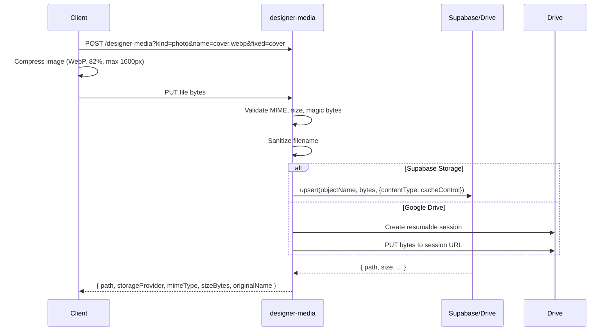

# Storage System

This document describes the complete file storage system in Dearune, including upload pipelines, provider abstraction, compression, and retrieval.

## Storage Architecture

```
┌─────────────────────────────────────────────────────────────────────────────┐
│                           STORAGE SYSTEM ARCHITECTURE                       │
├─────────────────────────────────────────────────────────────────────────────┤
│                                                                             │
│  CLIENT (Browser)                    EDGE FUNCTIONS                    STORAGE
│  ┌─────────────────┐                 ┌─────────────────┐        ┌────────┐  │
│  │  Designer       │ ──────────────▶ │  designer-media │ ─────▶ │Supabase│  │
│  │  Uploads:       │   1. Validate   │  - Validate     │        │ Storage│  │
│  │  • Photos       │   2. Sniff MIME │  - Compress     │        │        │  │
│  │  • Audio        │   3. Compress   │  - Upsert       │        │        │  │
│  │  • Drafts       │   4. Upload     │  - Signed URL   │        │        │  │
│  └─────────────────┘                 └────────┬────────┘        └────┬───┘  │
│                                                │                      │       │
│                                                ▼                      ▼       │
│                                  ┌─────────────────────┐        ┌──────────┐  │
│                                  │   GOOGLE DRIVE      │        │  LOCAL   │  │
│                                  │  (Optional Provider)│        │  (Dev)   │  │
│                                  │  - OAuth2           │        │  (None)  │  │
│                                  │  - Resumable Upload │        │          │  │
│                                  │  - Folder Hierarchy │        │          │  │
│                                  └─────────────────────┘        └──────────┘  │
│                                                                             │
└─────────────────────────────────────────────────────────────────────────────┘
```

## Storage Providers

### 1. Supabase Storage (Default)

**Bucket:** `designer-drafts` (private)

**Path Structure:**
```
designer-drafts/
├── {designerId}/
│   └── memorial-message/
│       ├── {fixed|uuid}.{ext}     # Template slots (fixed) or drafts (uuid)
│       ├── {uuid}.webp            # Compressed images
│       └── {uuid}.{ext}           # Audio files
├── wrappers/
│   └── {key}/                     # Wrapper catalog photos (admin-owned)
│       ├── photo.webp             # Fixed name → re-upload replaces it
│       └── photo-thumb.webp
└── templates/
    └── {slug}/                    # Template previews (admin-owned, slug = templates.slug)
        ├── preview.webp
        └── preview-thumb.webp
```

**Key Features:**
- **Path namespacing**: All drafts under `{designerId}/` - prevents cross-designer access
- **Studio assets**: `wrappers/<key>/…` and `templates/<slug>/…` are shared-read (admin writes only)
- **Upsert for template slots**: Fixed names (e.g., `cover.webp`) use upsert
- **Random UUIDs for drafts**: Prevents collision
- **Signed URLs**: 50-minute TTL (configurable via `SIGNED_URL_TTL`)
- **Cache Control**: `3600` seconds

**Access Control:**
- Designer: Own namespace only (`path.startsWith('${designerId}/')`)
- Designer: May resolve (read) studio assets (`wrappers/…`, `templates/…`)
- Admin: Full access via service role
- Public: Never direct access (via `project-media` with token)

**Template previews are the card art (one row, two screens):**
the admin Templates screen uploads to `templates/<slug>/preview.webp` (full,
≤1600px) plus `preview-thumb.webp` (≤400px), and persists the PATHS in
`templates.thumbnail_url` / `templates.preview_image_url` — never a public URL.
Both the admin cards and the `/create` paper chooser paint the same row:
`templatePreviewSource` (in `src/services/templates.js`) picks the column and
`resolveTemplateImageUrl` signs it through `designer-media?path=…` with the
caller's session (admin session or designer JWT). Replacing an image upserts
the same object names, so both screens show the new artwork on their next
resolve without any code or catalog change. A template with no readable image
falls back to a blank sheet on `/create`.

### 2. Google Drive (Optional)

**Configuration:**
- OAuth2 refresh token flow
- Root folder: `Dearune Designer Drafts`
- Per-designer subfolder: `{designerId}`

**Path Structure:**
```
Dearune Designer Drafts/
└── {designerId}/
    └── memorial-message/
        ├── {original_filename}.{ext}
```

**Key Features:**
- Resumable upload sessions (8MB chunks)
- Folder hierarchy auto-created
- Service account credentials via env vars

**Configuration (`app_settings`):**
```sql
storage_provider: 'supabase' | 'google_drive'
```

## Upload Pipeline

### Client-Side (`src/services/media.js` → `src/hooks/use-media.ts`)

```typescript
// 1. Compress image (max 1600px, WebP, 82% quality)
const compressed = await compressImage(file, 1600);

// 2. Initiate upload session
const session = await initMessageUpload({
  messageId,
  mediaType,
  fileName: compressed.name,
  mimeType: compressed.type,
  sizeBytes: compressed.size,
  token  // Designer JWT
});

// 3. Resumable upload (8MB chunks)
await uploadResumableFile(sessionUrl, compressed);

// 4. Complete → returns media reference
return { path, storageProvider, mimeType, sizeBytes, originalName };
```

### Server-Side (`supabase/functions/designer-media/index.ts`)

```typescript
// 1. Auth: requireDesigner or requireAdmin
// 2. Validate: kind (photo/audio), MIME, size limits
// 3. Sniff MIME from magic bytes
// 4. Sanitize filename (prevent traversal)
// 5. Upload to provider:
//    - Supabase: upsert if fixed name, else UUID
//    - Drive: resumable upload session
// 5. Return mediaRef with path, provider, MIME, size
```

## Compression & Optimization

### Image Compression (`src/lib/image-optimizer.ts`)

```typescript
export async function compressImage(file: File, maxDim = 1600): Promise<File> {
  const bitmap = await createImageBitmap(file);
  const scale = Math.min(1, maxDim / Math.max(bitmap.width, bitmap.height));
  const canvas = document.createElement('canvas');
  canvas.width = Math.round(bitmap.width * scale);
  canvas.height = Math.round(bitmap.height * scale);
  const ctx = canvas.getContext('2d');
  ctx.drawImage(bitmap, 0, 0, canvas.width, canvas.height);
  bitmap.close();

  const blob = await new Promise(resolve => 
    canvas.toBlob(resolve, 'image/webp', 0.82)
  );
  return new File([blob], file.name.replace(/\.[^.]*$/, '') + '.webp', { type: 'image/webp' });
}
```

**Defaults:**
- Max dimension: 1600px
- Format: WebP
- Quality: 82%

**Limits (by kind):**
| Kind | Max Size |
|---|---|
| Photo | 20 MB |
| Audio | 60 MB |

## MIME Type Sniffing

**Magic Byte Detection (`supabase/functions/designer-media/index.ts:46-67`):**

| Format | Magic Bytes | MIME |
|---|---|---|
| JPEG | `FF D8 FF` | `image/jpeg` |
| PNG | `89 50 4E 47` | `image/png` |
| WebP | `52 49 46 46 ... 57 45 42 50` | `image/webp` |
| GIF | `47 49 46 38` | `image/gif` |
| WAV | `52 49 46 46 ... 57 41 56 45` | `audio/wav` |
| OGG | `4F 67 67 53` | `audio/ogg` |
| MP3 | `ID3` or `FF FB` | `audio/mpeg` |
| WebM | `1A 45 DF A3` | `audio/webm` |
| M4A/MP4 | `ftyp` at offset 4 | `audio/mp4` |

## Media Reference Structure

```typescript
interface MediaRef {
  path: string;           // Storage path (e.g., "designerId/memorial-message/cover.webp")
  storageProvider: 'supabase' | 'google_drive';
  mimeType: string;       // MIME type
  sizeBytes: number;      // File size
  originalName: string;   // Original filename
  addedAt: string;        // ISO timestamp
}
```

**In Letter Payload:**
```json
{
  "photos": [
    { "path": "designerId/memorial-message/cover.webp", "name": "Cover", "type": "image" }
  ],
  "audio": {
    "path": "designerId/memorial-message/audio.webm",
    "name": "Voice note",
    "type": "audio"
  }
}
```

## Signed URLs & Retrieval

### Signed URL Generation

```typescript
// Supabase
const { data, error } = await sb.storage
  .from('designer-drafts')
  .createSignedUrl(path, SIGNED_URL_TTL);  // 900s default

// Google Drive
const token = await googleAccessToken();
const res = await fetch(`${DRIVE_URL}/files/${fileId}?alt=media`, {
  headers: await gdrive(token)
});
```

### Public Access (`project-media`)

```typescript
// GET /functions/v1/project-media?project={publicId}&token={token}&path={path}
// Returns:
{ "url": "https://...signed-url..." }  // or 302 redirect for images/audio
```

**Access Control:**
1. Project exists + `public_token` matches
2. `message_active = true`
3. Not password protected (`payload.passwordSet !== true`)
4. Not expired (`first_activated_at + 2 years > now()`)
5. Path exists in payload

**Response Modes:**
- `?redirect=1` or `Accept: image/*` or `Accept: audio/*` → 302 redirect
- Default → JSON `{ url: "signed-url" }`

## Media Upload Flow (Designer)



## Download & Streaming

### Range Requests (Audio/Video)

```typescript
// driveDownload supports Range header
const range = req.headers.get('range');
const driveRes = await driveDownload(token, path, range);
// Returns 206 Partial Content with Content-Range
```

### Streaming Response

```typescript
return new Response(driveRes.body, {
  status: driveRes.status,
  headers: {
    'content-type': driveRes.headers.get('content-type'),
    'content-length': driveRes.headers.get('content-length'),
    'content-range': driveRes.headers.get('content-range'),
    'accept-ranges': 'bytes',
    ...corsHeaders
  }
});
```

## Client-Side Media Handling

### `src/hooks/use-media.ts`

```typescript
export function useMedia() {
  const upload = async (file, options) => {
    // 1. Compress if image
    // 2. Get upload session
    // 3. Resumable upload
    // 4. Return MediaRef
  };

  const download = async (path, storageProvider) => {
    // Fetch signed URL or proxy through project-media
  };

  const remove = async (path, storageProvider) => {
    // DELETE to designer-media
  };

  return { upload, download, remove };
}
```

### Draft Media Store (`src/services/draftMediaStore.js`)

```javascript
// Dual persistence: localStorage + IndexedDB
const STORAGE_KEY = 'dearune.draftMedia';

export async function saveMedia(designerId, media) {
  // IndexedDB for large files, localStorage for refs
}

export async function loadMedia(designerId) {
  // Merge from both stores
}

export async function deleteMedia(designerId, path) {
  // Remove from both stores
}
```

## Storage Provider Abstraction

### `resolveStorageProvider()`

```typescript
async function resolveStorageProvider(sb): Promise<'supabase' | 'google_drive'> {
  const { data } = await sb.from('app_settings')
    .select('storage_provider').eq('id', 1).maybeSingle();
  return data?.storage_provider === 'google_drive' ? 'google_drive' : 'supabase';
}
```

### Provider-Specific Upload

```typescript
const provider = await resolveStorageProvider(sb);
const storagePath = provider === 'google_drive'
  ? await uploadToDrive(sb, designerId, bytes, mimeType, originalName)
  : await uploadToSupabase(sb, designerId, bytes, mimeType, extension, fixedName);
```

## Security

### Path Traversal Prevention

```typescript
function sanitizeName(name: string): string {
  const base = name.split(/[\\/]/).pop() ?? name;
  return base
    .replace(/[^A-Za-z0-9._-]/g, '-')
    .replace(/^\.+/, '')
    .replace(/-+/g, '-')
    .replace(/^-+|-+$/g, '')
    .slice(0, 80) || 'file';
}
```

### Namespace Enforcement

```typescript
// Designer can only access own namespace
if (!path.startsWith(`${designerId}/`)) {
  return errorResponse('Not yours to remove', 403);
}

// Studio assets under shared namespaces (admin writes only)
if (path.startsWith('wrappers/') || path.startsWith('templates/')) {
  if (!isAdmin) return errorResponse('Only the studio can change a studio asset', 403);
  if (!isStudioAssetPath(path)) return errorResponse('Not a studio asset', 403);
}
```

### MIME Validation

```typescript
const declaredMime = req.headers.get('content-type')?.split(';')[0].trim().toLowerCase();
if (!declaredMime.startsWith(requiredPrefix)) {
  return errorResponse(`A ${kind} must be ${requiredPrefix}*`, 400);
}

// Double-check with magic bytes
const sniffed = sniffMime(bytes);
if (!sniffed.startsWith(requiredPrefix)) {
  return errorResponse(`A ${kind} must be ${requiredPrefix}*`, 400);
}
```

## Limits & Quotas

| Resource | Limit |
|---|---|
| Photo size | 20 MB |
| Audio size | 60 MB |
| Total draft size | ~100 MB (localStorage limit) |
| Signed URL TTL | 15 min (designer-media), 900s (project-media) |
| Resumable chunk | 8 MB |
| Rate limit | 60 req/min (project-media), 10/min (designer-projects) |

## Migration Between Providers

```sql
-- app_settings.storage_provider = 'supabase' | 'google_drive'
-- Migration requires:
-- 1. Sync existing files to new provider
-- 2. Update media paths in all projects
-- 3. Flip app_settings switch
-- 4. Verify all signed URLs work
```

## Testing Storage

### Unit Tests

```javascript
// Vitest
test('compressImage reduces file size', async () => {
  const file = new File([largeBuffer], 'test.jpg', { type: 'image/jpeg' });
  const compressed = await compressImage(file);
  expect(compressed.size).toBeLessThan(file.size);
  expect(compressed.type).toBe('image/webp');
});
```

### E2E Tests

```javascript
// Playwright
test('Designer can upload photo', async ({ page }) => {
  await page.goto('/create');
  // ... login
  await page.setInputFiles('input[type=file]', 'test.jpg');
  await expect(page.locator('.photo-preview')).toBeVisible();
});
```

## Troubleshooting

| Issue | Cause | Solution |
|---|---|---|
| Upload fails | CORS | Check `_shared/cors.ts` origins |
| Signed URL 403 | Expired | Regenerate (15 min TTL) |
| Drive upload fails | Token expired | `googleAccessToken()` auto-refreshes |
| Large file timeout | Chunk size | Increase chunk size or timeout |
| Path traversal | Sanitization | Check `sanitizeName()` |
| MIME mismatch | Magic bytes | Check `sniffMime()` |

## Future Enhancements

- [ ] CDN integration for signed URLs
- [ ] Automatic thumbnail generation
- [ ] Multi-part upload for >100MB files
- [ ] Storage analytics dashboard
- [ ] Automatic cleanup of orphaned drafts